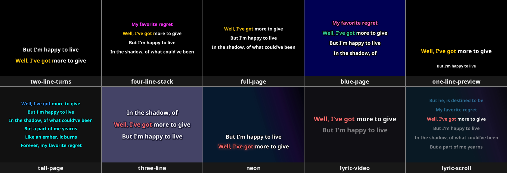
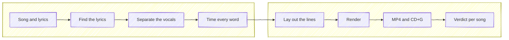

# 

[](https://github.com/laberning/vocatron/actions/workflows/ci.yml)

**Turn your CD collection, your digitized vinyl or your band's own recordings into your private karaoke collection.**

Vocatron turns a song and its lyrics into a karaoke track, locally, with as little manual work as possible.


*"My Favorite Regret" by Josh Woodward feat. Katie Pederson ([CC BY 4.0](https://creativecommons.org/licenses/by/4.0/)), made with the default look `four-line-stack`.*

Give Vocatron a folder of songs. It finds the lyrics, separates the vocals, times every word to the
singing and renders a karaoke video. Then it checks its own result and tells you which songs may
need some manual tuning.

> [!warning]
> Use Vocatron only with recordings you have obtained lawfully, and only for your private,
> non-commercial use unless the rights holders allow more. Songs, recordings and lyrics are
> protected by copyright: a karaoke track made from them may not be shared, published, performed in
> public or used commercially without the permission of the rights holders. You are responsible for
> complying with the copyright law that applies to you. Vocatron is provided "as is", without
> warranty of any kind (see [LICENSE](LICENSE)).

## Features

- **Runs on your machine:** no account, no upload; online only for setup, models and lyrics lookup.
- **Finds the lyrics:** a `.txt` or `.lrc` next to the song, or a lookup when there is none.
- **Separates the vocals** with AI models.
- **Times every word and syllable** to the singing, so the highlight follows the voice.
- **Ten looks:** seven classic, three modern, and your own by name.
- **MP4 video**, and CD+G (MP3+G) for karaoke players when you turn it on.
- **A verdict per song:** `ok`, `review` or `failed`, with the reason.
- **Fix the lyrics, run again:** only what changed is made again.
- **German and English** songs; MIT licensed.

## Quick start

Vocatron runs from a clone of this repository; it is not on PyPI. Requirements:

- Linux (WSL2 works; macOS is not tested), `git`, `make`, `curl`
- ffmpeg 8 or newer with libass and libx264, and `fdkaac`
- An NVIDIA GPU is recommended (others run on the CPU, much slower)

Hardware, disk space and the tools are described in the [install guide](docs/user/install.md).

```sh
git clone https://github.com/laberning/vocatron.git
cd vocatron
make setup                   # environment, PyTorch and checks; nothing outside the folder
make install                 # puts the vocatron command on your PATH (~/.local/bin)
vocatron doctor              # is this machine ready?
vocatron make ~/Music/party  # every song in the folder becomes a karaoke video
```

The models download themselves the first time a song needs them (about 1.6 GB for the models of
an English song); `vocatron models download` does it up front, `--language de` for German.

## Ten looks

Seven classic looks and three modern ones, all shown here at the same moment of the same duet
(see [Looks](docs/user/looks.md) for six moments of each, with the break screen and the end
screen):



*"My Favorite Regret" by Josh Woodward feat. Katie Pederson ([CC BY 4.0](https://creativecommons.org/licenses/by/4.0/)).*

## How it works



## Your first track

The freely licensed duet "My Favorite Regret" by Josh Woodward feat. Katie Pederson
([CC BY 4.0](https://creativecommons.org/licenses/by/4.0/)) comes with its lyrics:

```sh
make demo-songs                                                       # downloads the audio, checks its SHA-256
cp "tests/data/demo/Josh Woodward - My Favorite Regret.txt" .corpus/demo/
vocatron make ".corpus/demo/Josh Woodward - My Favorite Regret.mp3"
```

The video `Josh Woodward - My Favorite Regret.mp4` is in `.corpus/demo/karaoke/`. As an example,
this 4:27 song took about three minutes on a laptop with an 8 GiB NVIDIA GPU, models already
downloaded; on the CPU it takes much longer (the separation alone is about 20 times slower). For
your own songs, put `Song.txt` or `Song.lrc` next to each if you have the lyrics.

A German song works the same way: the freely licensed Systemabsturz "Verdächtig" (CC0) comes with
`tests/data/demo/Systemabsturz - Verdächtig.txt`; fetch its models with
`vocatron models download --language de`.

## Documentation

| Page | What is in it |
|---|---|
| [Installation](docs/user/install.md) | Requirements, setup, models, first track, troubleshooting |
| [Everyday use](docs/user/everyday.md) | The workflow from folder to summary |
| [Looks](docs/user/looks.md) | The ten looks, with pictures |
| [FAQ and known limits](docs/user/faq.md) | Questions and what Vocatron does not do |
| [Architecture](docs/dev/architecture.md), [decisions](docs/adr/README.md) | How it is built |

Contributions are welcome, see [`CONTRIBUTING.md`](CONTRIBUTING.md); `make help` lists every target
and `make check` runs the checks.

## Licence

MIT, see [`LICENSE`](LICENSE). Third-party software, models, fonts and the demo songs are listed in
[`THIRD_PARTY.md`](THIRD_PARTY.md); the models keep their own licences.
