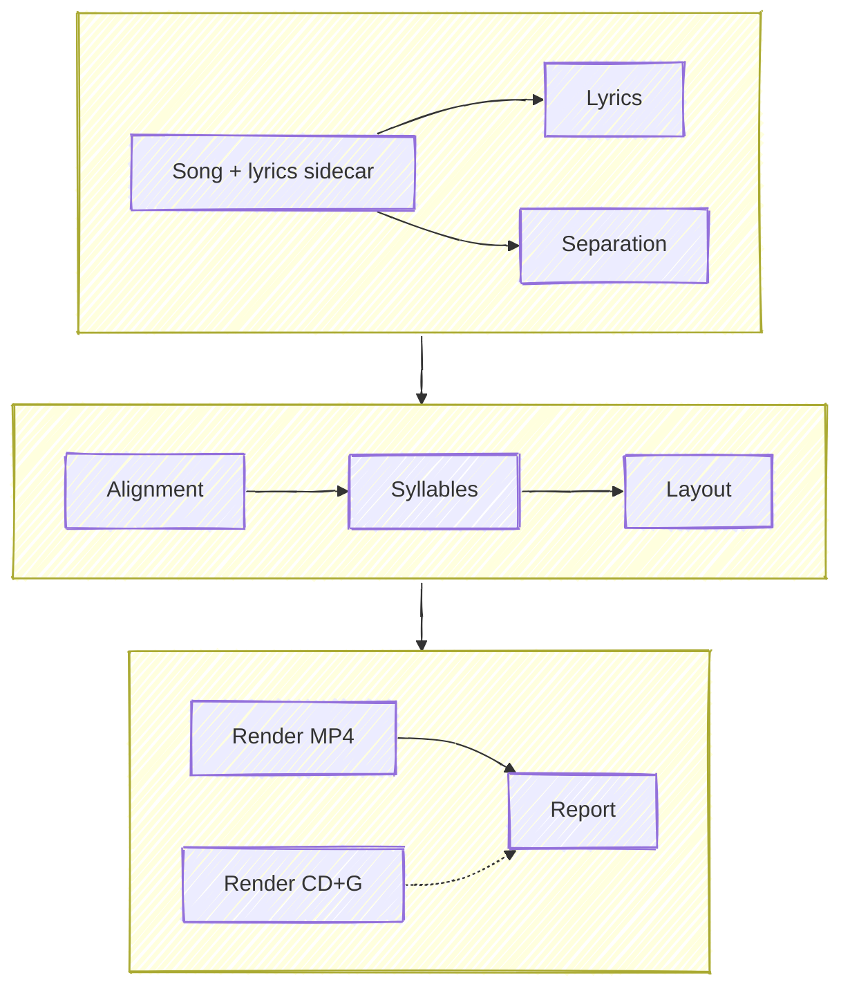

# ADR-0006: Pipeline stages and files

## Context and problem

Vocatron turns an audio file and its lyrics into a karaoke track through several stages, some of them slow GPU work. A user must be able to look at every intermediate result, fix one (for example the lyrics) and re-run from there; a new style must re-render in seconds without the AI stages; one failing song must not stop a batch. The input folder belongs to the user and should be touched as little as possible. Re-runs must stay correct when a song folder is copied, restored or synced through a cloud drive, which changes file times but not content.

## Considered options

1. **In-memory pipeline**: stages pass objects; only the final track is written.
2. **Stage files in a work folder**: every stage reads and writes typed files; any stage can run alone.
3. **An existing karaoke song format** (beat-based) as the exchange format between stages.

## Decision

Option 2. A beat-based format would round the timings to beats; timings stay in seconds from alignment to rendering. Whether a stage must run again is decided by fingerprints of its inputs and settings, not by file times.

### Stages

| Stage | Reads | Writes |
|---|---|---|
| Lyrics | lyrics sidecar, tags, file name | lyrics with singer marks and optional line times; lyrics status (`ok`, `review` with reasons, `missing`) |
| Separation | audio | lead vocals, backing vocals, instrumental (with or without backing vocals) |
| Alignment | lead vocals, lyrics, language | start and end per word, confidence, share of estimated words |
| Syllables | word timings, language | start and end per syllable |
| Layout | syllable timings, singers, song info, style profile | what is on screen when (title screen, lines, positions, wipes, breaks); independent of the output format |
| Render MP4 | instrumental, layout, style profile, output preset | MP4, enhanced LRC |
| Render CD+G | instrumental, layout, style profile | MP3 + CDG (later) |
| Report | results of all stages | song status and quality report; runs as the final step of every song, also a failed one, rather than as a skippable stage |

### Files and folders

- **Input** is a file (one song) or a folder: the audio files directly in it, not in subfolders, and never Vocatron's own output folder.
- **Output folder:** an option, default `karaoke/` inside the folder that holds the songs (the input folder itself, or the folder of an input file). One finished track per song, named `Artist - Title.mp4` (artist and title from the tags, the file name as fallback, made safe for file systems). The instrumental is kept as an output as well.
- **Work folder:** inside the output folder, one subfolder per song, named like the track. It holds every stage file, the subtitles, `status.json`, the quality report and a log file. Deleting the output folder removes everything Vocatron made.
- **The only write into the input folder** is the lyrics sidecar: `Song.txt` next to `Song.mp3` when lyrics were looked up, so the user checks and edits them where the music lives. An existing `Song.txt` or `Song.lrc` always wins.
- **Stage files** are JSON validated by Pydantic models; each carries a `schema_version` and a `fingerprint`: the SHA-256 of every input file's content (stage files and audio), the SHA-256 of the canonical JSON of the settings the stage uses (model names, revisions, relevant options), and the stage's own version. The JSON schemas are exported and committed (ADR-0004). Audio stems are WAV or FLAC in float or normalised. Config and style profiles are YAML (ADR-0002).
- **Config:** `vocatron.yaml` in the current folder or given with `--config`; command-line options override it.

### Running stages

- A stage is skipped when its output exists, validates against its schema and its stored fingerprint equals the one computed now; otherwise it runs, and `--force` runs it regardless. A hand-edited stage file is an input of the next stage, so its new content re-runs everything after it.
- Each stage declares the settings it depends on as part of its type; a setting it reads but does not declare would not trigger a re-run, so tests check the declaration.
- Commands at the top level: the whole pipeline, the lyrics step alone, re-rendering from the work folder, and a status overview.
- **Song status** is written before and after every stage. While stages remain it is `running` with the name of the current stage, so a song interrupted by a crash or a kill never looks finished. After the last stage, or when a stage fails, it is `ok` (lyrics trusted, sync report under the threshold, track rendered), `review` with reasons (lyrics unsure, too many estimated words, suspicious gaps) or `failed` with the error. A track is produced whenever possible, also for `review` songs. Only a song without any lyrics stops before alignment.
- **Errors are per song:** a failing stage marks its song `failed`, the batch continues, every song has a timeout, and the exit code says whether all songs succeeded. The log file per song is flushed as it is written, so a crash leaves evidence.

## Consequences

- Every intermediate result is inspectable and editable, and re-rendering a new style needs no GPU.
- Re-runs are correct after copying, syncing or restoring a folder; a changed setting re-runs exactly the stages that use it. Hashing the audio costs well under a second per song.
- Nested folders need a later option (`--recursive`) and its own decision.
- Stage files are a public format inside the work folder: changing one needs a schema version bump and a test (ADR-0004).
- Disk use per song is a few hundred megabytes of stems in the work folder; the user deletes the output folder to reclaim it.
- The pipeline frame (CLI, config, folders, stage protocol, status, logs) is built once before the first real stage.
