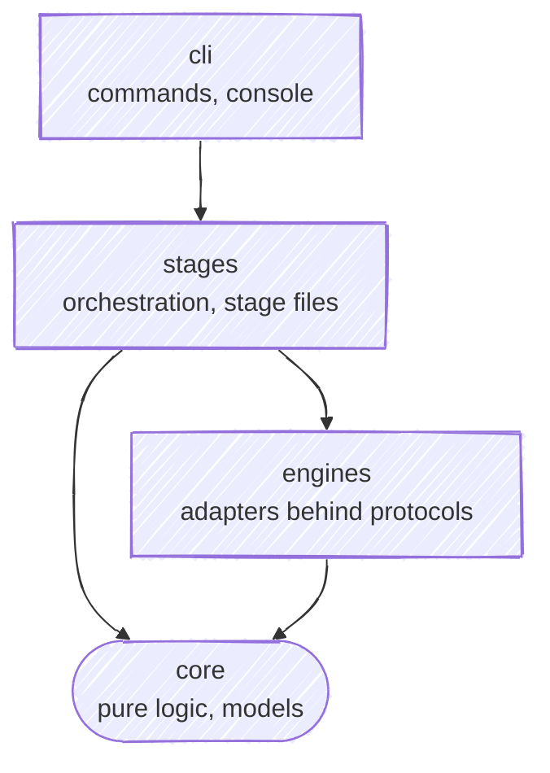

# ADR-0007: Architecture and code quality

## Context and problem

Vocatron is changed by many hands, human and automated, and must stay clean for a long time. Conventions that only live in people's heads weaken quietly. The project needs an architecture that keeps everything that decides testable without models or I/O, extension points that new languages, profiles and output formats plug into the same way, and quality gates that are enforced by tools in the one check command, so that a change that breaks the architecture fails the build.

## Considered options

1. **Conventions documented, checked in review.**
2. **Layered architecture with tool-enforced gates** in `make check`.
3. **Plugin framework** (entry points) for every extension.

## Decision

Option 2. Registries inside the package are enough; external plugins are not needed now.

### Layers

| Layer | Contains | May import |
|---|---|---|
| `core` | typed models and pure functions for everything that decides: lyrics cleaning, alignment maths, syllables, layout, timing, status rules, format writers | the standard library, Pydantic, NumPy; **never** torch, transformers, ffmpeg calls, network or file I/O |
| `engines` | adapters for the heavy parts behind protocols: separator, acoustic model, transcriber, lyrics source, renderer, downloader, file store, clock | `core`, the engine libraries (lazy imports) |
| `stages` | one module per pipeline stage: read stage files, call `core` and engines through their protocols, write stage files and status | `core`, engine **protocols** only |
| `cli` | commands, config loading, console output | `stages`, `core` |

- Engines are chosen at the edge (`cli`) and passed in. **Every engine protocol has a fake** in the test fixture library; the whole pipeline runs on fakes in stage 1 (ADR-0004).
- **Clock and randomness are injected**; nothing in `core` or `stages` reads the time or seeds randomness itself.
- **No network in stages 0 and 1** (pytest-socket); heavy imports (torch, transformers) happen lazily inside engines, so the fast tests never load them.
- **Extension points are registries with a conformance test kit**: languages (ADR-0005), style profiles, output renderers. A new entry proves itself by passing the same kit as the existing ones.

### Gates

All run in `make check` unless noted; versions checked on 2026-10-28 and pinned in `uv.lock`.

| Gate | Tool | Rule |
|---|---|---|
| Format, lint | Ruff 0.17 | `ruff format --check`; rule families E, F, W, I, UP, B, SIM, PL (subset), PERF, C901 and PLR09xx complexity limits, D (Google docstrings), PGH003/PGH004 (no blanket ignores), RUF100 (no unused `noqa`). Every `noqa` carries a reason text (reviewed, Ruff cannot enforce it) |
| Types | Pyrefly 1.4 | `preset = "strict"`, errors for implicit and explicit `Any`, unannotated returns and unused ignores; relaxed overrides only for `tests/`. ty runs as an advisory job allowed to fail until it leaves 0.0.x |
| Layers | import-linter 2.15 | `layers` contract `cli` > `stages` > `engines` > `core`; `forbidden` contracts: `core` never imports torch, transformers, urllib3, subprocess or engines; `stages` imports engine protocols only |
| Dependencies | deptry 0.25; `uv lock --check` | no unused, missing or transitive-only dependencies; lock file current |
| Dead code | vulture 2.16 | with a committed whitelist for framework entry points |
| Duplication | jscpd 5.4 (`make dup`) | no new clones above the configured size |
| Tests | pytest 9.2, pytest-randomly 5.0, pytest-xdist 3.8, pytest-timeout 2.4 (below the yanked 2.5), pytest-socket 0.8, Hypothesis 6.170 (`ci` profile), syrupy 6.1 | as in ADR-0004 |
| Coverage | coverage.py 7.17, pytest-cov 7.1, diff-cover 11 | branch coverage; `core` 95 %, `stages` 90 %, `cli` 80 %, `engines` 60 % on the fast stage |
| Mutation | mutmut 3.8 (`make mutation`, on demand) | run on touched `core` modules before a change is accepted; surviving mutants are fixed or explained |
| Schemas | Pydantic `model_json_schema`, committed | stored stage files validate; schema diff requires a version bump |
| Summary | `make summary` | prints only failures with file, line and message from the reports |

## Consequences

- An architecture violation, a missing docstring, a weakened type check or a new clone fails `make check`, not a review discussion.
- Every stage story gets the layers, engine protocols, fakes and fixtures for free from the pipeline frame and adds only its own logic and tests.
- The gate configuration itself is code: lowering a threshold or removing a contract is visible in the diff and counts as weakening a gate (ADR-0004, Definition of Done).
- Some tools are young (Pyrefly 1.x, jscpd's rewrite, ty); a tool that stalls is replaced by a new ADR, its rule stays.
