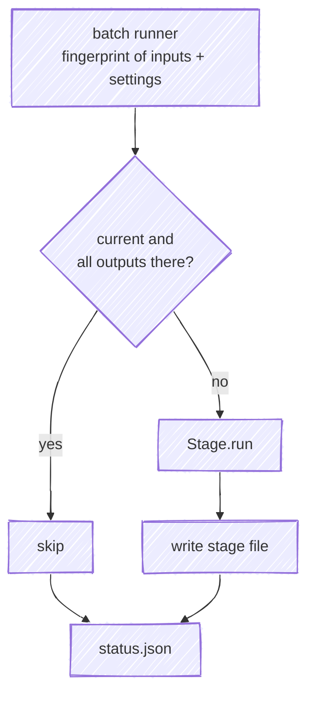

# Adding a stage

The pipeline frame ([ADR-0006](../adr/0006-pipeline-stages-and-files.md),
[ADR-0007](../adr/0007-architecture-and-code-quality.md)) does everything around a stage: finding
songs, work folders, fingerprints, skipping, `status.json`, the log, error isolation and exit
codes. A stage only says what it reads, what it writes and how.

Before each stage the runner writes `status.json` with the state `running` and the stage's name,
so a crash or a kill leaves the song visibly unfinished; after the last stage, or a failure, it
writes the final state. A stage does not write the status itself. A partial run (`until`, as
`vocatron lyrics` uses it) keeps the results that `status.json` recorded for the stages after
`until` and replaces only its own (`vocatron.core.status.untouched_results`). A kept result stays
only if the stage's file is still current for its inputs and settings (a stage whose input is
stale counts as stale too); otherwise the stage is `outdated` and the song needs review with the
reason "not finished, run `vocatron make`". A stage that `status.json` shows as running is
`interrupted`.

After the last stage (or a failure) the runner also makes the song's report (`report.json`,
`vocatron.stages.report`) from the final status and the stage files; a stage adds to it only
through its `reasons` and its stage file. A stage that runs for a long time reports how far it
is with `ctx.watch.progress(fraction)` (an engine with `request.watch.progress`), and an engine
that starts a process must also respect `ctx.watch.time_left()`, the safety limit of the song.

## Recipe

1. **Rules** that decide (maths, cleaning, scoring) go in `vocatron.core` as pure functions with
   property tests. A topic of several modules gets a folder named like its stage
   (`vocatron/core/<topic>/`, with its tests in `tests/fast/core/<topic>/`); a topic of one
   module stays a flat module. The stage only orchestrates.
2. **Engine** (model, ffmpeg, network): a protocol in `vocatron.engines.protocols`, a real engine
   with lazy heavy imports, and a **fake** in `tests/fakes/`. A stage sees engines only through
   the protocols; add the engine to `Engines` in `vocatron.stages.stage`. A protocol lives in
   the lowest layer that calls it: a protocol that code in `core` calls goes in `core`, because
   `core` may not import `engines`. The text measurer (`TextMeasurer` in `vocatron.core.measure`,
   called by the layout) is the example; it has an engine and a fake like any other.
3. **Stage file** model: a subclass of `StageFile` with `SCHEMA_NAME`, `schema_version:
   Literal[1] = 1` and its fields. Review reasons go in `reasons`. It lives in
   `vocatron/core/<topic>/file.py`; the messages between the stage and its GPU worker, if it has
   one, in `vocatron/core/<topic>/job.py`. A one-module topic keeps its stage file in that
   module (`vocatron.core.tempo`).
4. **Settings**: a `Settings` model in `vocatron.stages.config` and a section of the same name
   in `Config`. (A stage with nothing to set, like `tempo`, declares an empty `BaseModel` and
   has no section; the registry test names it.) Everything the stage reads from the
   configuration must be in that section, because its hash is part of the fingerprint. Add the
   keys to `docs/user/config.md`.
5. **Stage** class in `vocatron/stages/<name>.py`, based on `TypedStage[YourSettings]`:
   `name`, `version`, `inputs` (`AUDIO` and names of earlier stage files), `output`,
   `output_model`, `settings_from` and `run`. A stage that needs models lists their registry
   names in `models` (for example `models = ("wav2vec2-de",)`); the runner downloads missing ones
   just before the stage runs, or fails the song with the command to run when `--offline` is set.
   When the configuration or the song chooses the models, override `required_models(ctx, config)`
   instead; `declared_settings(ctx, config)` gets the song's context too, so a stage can depend
   on the song (the alignment on the language of its lyrics, ADR-0016).
   Files the stage writes besides its stage file (the stems, for example) go into
   `extra_outputs`, relative to the work folder; the runner skips the stage only when the stage
   file is current and every declared output exists, so a deleted file runs the stage again.
   A stage whose inputs include a file outside the work folder that the configuration chooses
   (a style profile) returns its hash from `external_inputs(ctx, config)`, and a stage that
   writes finished files outside the work folder (the render) lists them in `products(ctx,
   stored)` from its stage file, so the stage also runs again when one of them is missing.
   A new model goes into the registry (`vocatron.core.models`) and `THIRD_PARTY.md`; a fast test
   keeps the two in step. Raise `StageError(kind, message)` for failures a
   user can act on; anything else is caught and logged with its traceback. Bump `version` when
   the output changes for the same input.
6. **Register** it in `STAGES` in `vocatron.stages.registry`, in pipeline order.
7. **Schema**: run `make schemas` and commit `schemas/<name>.v1.json` together with
   `schemas/SHA256SUMS`. A later change to the model needs a `schema_version` bump and a new
   schema file; the fast tests fail otherwise. Stage files are a public format (ADR-0006), so a
   committed schema file is never changed or deleted, also after its model moved on to a newer
   version: `schemas/SHA256SUMS` pins the SHA-256 of every committed schema file, a fast test
   fails when a file differs from its line, is missing or has no line, and `make schemas` only
   adds lines for new versions (it stops, writing nothing, when a schema of an existing version
   would change).
8. **Tests** in stage 1 with `FakeWorld` from `tests/fakes/songs.py` (fake clock, tags and file
   store, canned songs, a fake downloader that serves canned model files). The registry conformance tests run on your stage without changes.

## Fakes

| Protocol | Fake | Use |
|---|---|---|
| `Clock` | `FakeClock` | Deterministic time, one second per call. |
| `TagReader` | `FakeTagReader` | Canned tags; `None` means unreadable. |
| `FileStore` | `InMemoryFileStore` | Files as bytes, logs as lists. |
| `Separator` | `FakeSeparator` | Writes tiny canned stems. |
| `AcousticModel` | `FakeAcousticModel` | "Sings" the lyrics of `lyrics.json` as clear spikes, so word times are known exactly; `shift` and `jitter` move the lines against their `.lrc` times. |

`write_wav` in `tests/fakes/songs.py` generates tiny WAV files for tests on the real engines.
