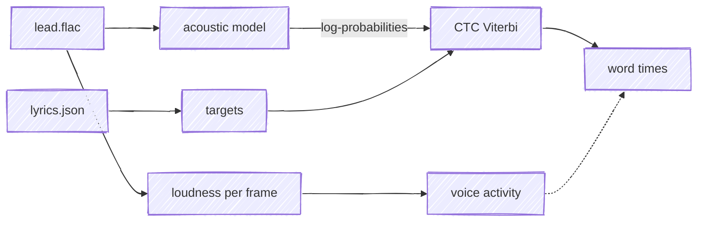

# Alignment and the sync benchmark

## From audio to word times

The pure parts live in `vocatron.core.alignment` (its stage file `alignment.json` is `file.py`,
the messages to the acoustic worker are `job.py`); the stages (`vocatron.stages.alignment`,
`vocatron.stages.syllables`) only orchestrate.

| Module | Job |
|---|---|
| `tokens` | Lyric lines to words (as written and as spoken) and to the targets of the search; maps target spans back to words. |
| `ctc` | The Viterbi search over the CTC trellis with optional frame windows per token. It returns the path and the log-probability the model gave each frame's label. For the same input its path equals torchaudio's `forced_align` frame for frame (a stage 2 test checks it on a whole song). |
| `chunks` | Plans pieces of 30 seconds with 2 seconds of overlap (on frame boundaries) and stitches their frames by index, taking the first piece up to the middle of the overlap. `sum_waves` adds two waves sample by sample (the shorter padded with zeros). `frame_loudness` is the RMS in dBFS per frame over the model's own windows (400 samples, stride 320) of the decoded wave before normalisation, so it has `frame_count` entries and frame `t` covers the samples of emission frame `t`. |
| `voice` | Voice activity (ADR-0012). The threshold is the `VOICE_PERCENTILE` of the loudness inside confident words (confidence at least `CONFIDENT_WORD`) minus `VOICE_MARGIN_DB`, but at least the song's `FLOOR_PERCENTILE` plus `FLOOR_MARGIN_DB`. Voiced frames are smoothed (holes under `CLOSE_HOLE_SECONDS` closed, islands under `MIN_VOICED_SECONDS` dropped). A song is plausible when the median loudness of confident words is `MIN_CONTRAST_DB` above the floor of all frames (not above the frames the threshold came from) and the voiced share lies in `MIN_VOICED_SHARE` to `MAX_VOICED_SHARE`; otherwise `find_voice` returns no activity and a fixed reason. |
| `mix` | Hearing the backing (ADR-0014). `mix_backing` chooses the frames that take the backing's row of the log-probabilities: outside the lead's own voice (`find_voice` on the lead loudness with the confident words of the lead pass; no plausible voice gives `lead voice not plausible`), the lead's most probable token is the blank, outside every confident word of the lead pass, the backing's loudness above the lead's threshold and `FLOOR_MARGIN_DB` above its own `FLOOR_PERCENTILE` floor (smoothed like the voice), and runs of at least `MIN_VOICED_SECONDS`. All constants are the voice's, so there are no new ones; the rows are log-softmaxes over one vocabulary and need no renormalisation. No swapped frame gives the lead's matrix itself (`no backing frames`). `words_in` counts the measured words whose letters lie mostly in the swapped frames. `second_voice_rows` gives the matrix of a second voice (ADR-0052): the backing's rows where it sounds (`backing_sounds`, the same threshold as above) and the first voice's elsewhere; without windows (`bounded` false) the backing's matrix as it is, since rows of the lead would hold the other voice's letters for the whole song. |
| `rails` | First `in_order` keeps the largest non-decreasing set of hints (longest non-decreasing subsequence, O(n²); equal times are in order). Among sets of the same size it keeps the one whose hints lie closest to the line starts of the pass without hints after the median offset of all pairs, so of two contradicting hints the one further from its start is dropped; without starts, or on a tie, the later line is dropped. The dropped lines go to `RailCheck.dropped` for every outcome. Then it compares the line starts found without hints with the `.lrc` (median offset; consistent when the median absolute deviation is at most 0.3 s and at least 60 % of the lines lie within 0.5 s of it) and builds the windows: a line lies between 1.5 s before its corrected time and 1.5 s after the corrected time of the next line. With a second voice `voice_windows` gives every voice its own windows (a line ends at the next line of its voice); a second-voice line also ends at most `REACH` (3 s) after the next later time of any voice, and lines that share one time end at most `SLOT_REACH` (0.2 s) after it, in both voices. `crowded_lines` returns the lines of either voice whose window overlaps the window of a line of the other voice. Corrected times are clamped to the song, and a window is at least 1.5 s long (or the whole song if shorter), so a line hinted at the very end or out of order never gets an empty window; if the kept hints still leave no path, the second pass is dropped as below. |
| `estimate` | Confidence of a word: the mean over its letters of the highest probability the path gives the letter. A word below 0.1 (`MIN_CONFIDENCE`, chosen on one corpus song; the benchmark is where to revisit it), or without sound, is estimated. Without a voice, a run takes the time between its neighbours in proportion to the letters. With the voice, `on_voice` starts the run at the first voice start in its gap (a voice that sounds from the gap's beginning and stops within `HELD_TAIL_SECONDS` is the previous word's held note when another start follows; a voice that goes on is the run's own start), lets every word last its letters times the song's seconds per letter (median of confident words, clamped to `MIN_LETTER_SECONDS`..`MAX_LETTER_SECONDS`), moves a following word to the next voice start if the voice paused, and compresses the run into the gap if it would pass the next measured word. At the song's edges the voice start is looked for within `EDGE_REACH_SECONDS` of the neighbour (the last start that leaves room for the run before the first word). No voice start, or voiced time under `MIN_FILL_SHARE` of the run's need, gives the proportional placement. A measured word with confidence under `SILENT_CONFIDENCE`, at least `MIN_JUDGED_SECONDS` long and under `SILENT_SHARE` voiced is turned into an estimated one (confidence kept, letters dropped) first; if the voice then cannot place its run, it keeps its measured time and the run is settled again without it. With the voice in use and the words' lines passed by `solve._timed` (`lines=`; ADR-0021) two things change before the placement above: first `_kept` keeps an unsure word at the model's (Viterbi) start, as an estimated word, when at least `KEEP_VOICED_SHARE` of its span is voiced, or when it ends at most `KEEP_NEXT_SECONDS` before the next word of its line that is kept by confidence (kept words never anchor each other; silence re-estimates are never kept; for a line's first word the voice at its start must have begun after the previous word's Viterbi end, so a held note of the line before does not count, unless the word starts at most `KEEP_DIRECT_SECONDS` after that end); its end is the later of the model's end and start plus letters times the song's seconds per letter, never after the next word's start (`hold_ends` holds only measured words). Then `_runs` splits the remaining runs at line breaks and `_fill` places them right to left with `_line_window`: a run that starts a line (or a whole line) goes backwards from the next placed word (`on_voice` in leading mode, the voice already sounding at the gap's start is no onset; fallback right before the next word, never at the gap's start; the floor is the end of the previous measured or kept word), a run that ends a line goes forward from its last word at most `EDGE_REACH_SECONDS` and not past the next placed word, a run inside a line is placed as described above. A silence re-estimate that the voice cannot place goes back to the model's start, also when a kept neighbour has shrunk its gap to the voice at the gap's end: the voice detection can miss quiet singing over a loud backing, so the model is trusted there. Every decision is recomputed in each iteration of the re-estimate loop. Without the voice, or without `lines`, nothing of this applies. `VoiceReport.kept` and the `voice` block (`kept`, schema 6) count the kept words. Every number is a named constant with its reason in its docstring and in the stage's fingerprint (`VoiceParameters`). |
| `hold` | Word ends on the voice (ADR-0013): a measured word whose last letter lies in a voiced run ends where the run ends, at the next word's start or `MAX_HOLD_SECONDS` after its last letter, whichever comes first; see below. |
| `quality` (`core/quality.py`) | The quality report and the review reasons. `split_reasons` (ADR-0053) names a line whose longest inner gap (held ends, so a held note is no gap) is at least `SPLIT_GAP` long, with the voice sounding in under `SPLIT_SILENT` of it, and whose words before the gap are all measured with a mean confidence under `SPLIT_CONFIDENCE`: the first words were pulled into the singing before, so the line time looks early. It looks at the aligned words, so it also names lines the rails did not move. Trial on 18 corpus songs with `.lrc` times: dropping every hint that lies over 2 s from where the pass without hints found its line (the first idea of ADR-0053) moved 9 lines in 7 songs, 7 of them 2 to 20 s away from a line time that was right, and did not move the Stumblin' In case at all (the pass without hints puts its first words in the line before as well); only the report stays. The numbers are in the fingerprint (`SplitParameters`). |
| `unheard` | Lines the model did not hear (ADR-0027). `place_unheard` runs in `solve` after the second pass (rails `shifted`) on the settled words with the kept hints and the rails offset. A line is unheard when it has a hint and all its words are estimated. Lines are processed last to first. The first word starts at `hint + offset`, raised to `AFTER_PREVIOUS_SECONDS` after the start of the last measured word before it (estimated words between do not lower it, so no measured word is moved) and capped at the next line's start (so a late hint never reorders the words); the words go on the voice up to the next line's start with `estimate.on_voice` (the song's seconds per letter from `estimate.letter_seconds` over the letters of its confident words, not their held ends), or, without voice or when the placement starts more than `SNAP_SECONDS` after that start, are shared over letters x `LETTER_SECONDS` with `estimate.share`. `_cut_before` ends the words before at the new start (a measured word's letters too, so none outlasts it); estimated words the model put after it move to it with no length, so no word overlaps and the order is kept. It returns the placed lines (`UnheardLine`: rail and the end of the window, the next rail or rail + letters x `LETTER_SECONDS`) for `quality.unheard_reasons`, which names lines with under `MIN_UNHEARD_VOICE` voiced in that window (one reason, up to `MAX_LISTED_LINES` line numbers, then a count). `VoiceReport.unheard` and `voice.unheard` (schema 7) count them. `forget_late` makes the judged lines that start more than `LATE_SECONDS` after their rail unheard (ADR-0052); `solve` judges, in each voice's pass, only the lines whose window overlaps the window of a line of the other voice (`rails.crowded_lines`): the first voice's lines that took words the backing carries for the second voice, and the second voice's lines that the backing does not carry and that took the first voice's words (ADR-0054). |
| `voices` | A second voice in the audio (ADR-0052). `hear` searches every line with a hint, in its window, on the lead's output and on the backing's output and gives a `Hearing` (the confidence on each, the lead stem's voiced share until the next line, the letters and the slot to the next line). `choose` keeps the file's second-voice lines and adds a line when `BACKING_MARGIN` (backing better than lead by 0.2), `LEAD_SILENT_SHARE` or `LEAD_DEAF` (the lead stem is voiced in at most 0.25 of the slot, or the lead's confidence is at most 0.15), `CROWDED` (letters per second of the slot at least 1.5 times the song's median) and `FREE_SHARE` (the line before on the second voice was due at least 0.65 of the median slot earlier) all hold. Extents of lines measured one by one are not used: a single line searched in a window takes letters from the lines around it and runs on. The constants were tuned on two songs with two voices and checked on the corpus (no one-voice song gains a second voice that `word-voice` does not show), and are in the fingerprint (`SecondVoiceParameters`). |
| `solve` | The two passes: unconstrained, then, after the order check, if the kept hints fit, confined to their windows. A second pass without a path is dropped and the hints count as ignored. Each pass finds the voice from its own measured words (`_timed`) and settles the words on it and then holds the measured ends on it (`hold`), so the rails check sees the better line starts of the first pass; `Solution.voice` is the report of the pass that gave the words. `Switches(voice_activity=False)`, or emissions without `loudness`, give the earlier words exactly. With `hear_backing` and a `backing` part on the emissions, the lead pass runs first and gives the confident words, `mix_backing` chooses the frames, and if any frame is swapped the first pass runs again on the mixed emissions (the rails check and the rails pass use them too, one more Viterbi pass); `Solution.backing` is the report. Without a swapped frame, with the setting off or without a backing part the words are those of the lead alone. With a second voice (`voices=` from `lyrics.json`, plus the lines `voices.choose` adds when the rails are `shifted` and the backing is heard) the second pass runs once per voice (`_second_pass`): the lines of the voice become their own transcript, are searched on the voice's matrix inside the windows of `voice_windows`, settled and placed (`_voice_pass`; the second voice takes the first's voice detection, since the loudness is the song's), and the words go back into the order of the lyrics. The first voice runs on the lead's matrix with the backing mixed in, and in the backing the second voice sings: where it sings, the first voice can take the second voice's words and start a line seconds after its line time. With a second voice, `unheard.forget_late` therefore turns, in the pass of each voice, every line whose window overlaps the window of a line of the other voice (`rails.crowded_lines`; a line far from the other voice is not judged, a late start there is the singer's own; a second-voice line the backing does not carry searches the lead's rows and can take the first voice's words) and whose first word is measured and starts more than `LATE_SECONDS` (1 s) after its line time plus the offset into an unheard line (all words estimated), and `place_unheard` puts it at its line time as it does for any line the model does not hear (ADR-0027); it also cuts the line before to its start. Songs with one voice are not touched. A second voice without fitting line times is searched over the whole song on the backing alone. If two voices have no path, one voice has none either (each window of two voices holds the line's window with one voice), so the second pass is dropped as without a voice. `Solution.voices` and `Solution.found` name the voice of every line and the lines the audio added; `AlignedLine.voice` (`alignment.json` v8) stores the voice, so line spans of the two voices may overlap and words are in the order of the lyrics, not of time. Without a second voice the second pass is one path through all lines. |

Pieces rather than one pass: wav2vec2 was trained on short utterances. On "Denkmal" the pieces
give a median line-start error of 165 ms, one pass over the whole song 220 ms.

## The acoustic model as an engine

`AcousticModel` (`vocatron.engines.protocols`) returns the log-probabilities of a song. The real
one, `ProcessAcousticModel`, starts `python -m vocatron.engines.alignment.worker` in a child
process; the process handling (probe, device choice, timeout, exit codes, job and result files)
is shared with the separation in `vocatron.engines.gpu_process`, and the worker's frame
(`vocatron.engines.gpu_worker`: log, VRAM cap, exit codes) as well. The frames come back in a
NumPy file, and the loudness of the vocals per frame in a second one (`AcousticJob.loudness_path`, `alignment-loudness.npy`); the parent checks both against the result's frame count and deletes them. A worker that leaves no valid loudness file fails with `alignment-failed` like one without frames. The parent imports no PyTorch; a contract enforces it. The fake,
`tests/fakes/acoustic.py`, "sings" the lyrics of the song as clear spikes, so every stage test
knows exactly where each word is, and gives loud frames over each sung word and quiet ones
between (`loudness = False` gives none; `backing_words` are quiet unless the request adds the backing stem to the lead, `sum_backing`).

With `alignment.hear_backing` the stage also asks for the backing's output (`AcousticRequest.hear_backing`): the worker decodes the backing stem once, pads or trims it to the lead's length, normalises it on its own and runs the loaded model a second time over the same pieces. It writes three more files (`alignment-backing-emissions.npy`, `alignment-lead-loudness.npy`, `alignment-backing-loudness.npy`) that the parent checks like the others and deletes in `finally`; `Emissions.backing` holds them (`None` when off). The existing loudness file is not derived from the two: the loudness of a sum is not the sum of loudnesses. `backing` in the request is set whenever either `voice_source: vocals` (`sum_backing`) or `hear_backing` needs it. The fake gives `backing_only` words (blank in the lead, spikes in the backing) next to `backing_words`.

`alignment.voice_source` is `vocals` (the default, chosen on the benchmark and the demo song, ADR-0012) or `lead`. With `vocals` the stage puts the backing stem in `AcousticRequest.backing` and the worker adds it to the lead wave (`chunks.sum_waves`) before `frame_loudness`; the emissions come from the lead (and, with `hear_backing`, the backing where the lead is silent, see above), never from the summed wave. `stems/backing.flac` is always an input of the stage (the separation always writes it, and a stem it forgets fails the separation); a backing file that cannot be decoded fails the worker with `alignment-failed`, and the setting is in the fingerprint through `Pinned.voice_source`.

## Word ends on the voice (ADR-0013)

`vocatron.core.alignment.hold.hold_ends` runs in `solve._timed` after `settle`, with the voice activity of the same pass. For each measured word with letters it takes the voiced run that holds the middle of the last letter's last frame; the new end is the earliest of the run's end, the next word's start (estimated words count) and the last letter's end plus `MAX_HOLD_SECONDS` (4 s, in `VoiceParameters`, so in the fingerprint). Ends only move later; starts, letters and estimated words are untouched, so line starts and the rails check do not change. `VoiceReport` and the `voice` block carry `held` and `held_median`. Without a plausible voice nothing moves.

`AlignedWord.heard_end` (last letter's end, else `end`) is the one place that tells the heard end. `quality.report` judges "too short" on `end - start`, "too long" on `heard_end - start` and gaps on `end` (ADR-0017). `syllables.split_word` gives the held time to the last syllable: with fitting letters that comes from `word.end`, in the proportional fallback the heard part is shared and the last syllable is extended to `end`.

## Diagnosing the voice under the words

`make word-voice SONG=<work folder>` (`tools/word_voice.py`, `vocatron.lab.alignment.word_voice`) measures a finished song again with the lead and the backing stem apart and prints, per word and by index only (never the text): line, start, duration, confidence, the voiced share and the time to the first voice on each stem, the share on the voice the alignment used (both stems added), and the longest silence inside the word on both stems. The thresholds are those of the voice check (`find_voice` on the lead, and for the backing the lead's threshold but not closer to its own floor than `FLOOR_MARGIN_DB`, as in `mix_backing`). A word is flagged `no-voice` (neither stem sounds in it), `early` (the voice starts more than 0.3 s after the sweep starts) or `crosses` (a silence over 0.5 s inside it). `ROWS=all|none` changes the rows; `ALL=1` takes a folder of work folders and prints one summary line each. Nothing in a `vocatron` command runs it.

## Tests

| Stage | What |
|---|---|
| 1 | Second voice: the choice on invented hearings (every sign alone, a free voice, the file's lines), the windows of the voices, and `solve` on emissions in which a second voice sings at once with the first (the same time and a partial overlap from the audio, a song with one voice unchanged, a first-voice line whose words the backing carries for the second voice stays at its line time); the lines of a lyrics file with `{&}` and shared times. Property tests of the held ends (never earlier, ordered, no overlap, capped), table tests of the cap, the next word and the unvoiced last letter; property tests of the loudness (frame count, a burst is loud exactly in its frames) and of the voice spans (ordered, long enough, invariant under a gain in dB); table tests of the voice and of every placement rule and fallback; property tests of the Viterbi (collapses to the targets, every token covered, no overlap, as good as a brute-force search on tiny inputs, invariant under padding with blanks, windows respected); table and property tests of the rails, the estimation, the pieces, the quality rules, the German speller and the syllables; the stages on the fake; the worker on a tiny random wav2vec2; the per-word voice diagnosis (`lab.alignment.word_voice`) on invented spans: a word only the backing sings, a word in silence, a sweep that starts before the voice, a word stretched over a breath. |
| 2 | `tests/slow/test_alignment_real.py`: our Viterbi against torchaudio on the real log-probabilities of "Denkmal"; pieces against one pass and against other overlaps; "Denkmal" end to end without rails, median line-start error at most 236 ms (the trial's). |
| 3 | `make bench`. |

## The benchmark

`make bench` runs the whole pipeline on every song in `.corpus/songs/` (German) and in
`.corpus/songs-en/` (English); the corpus is never in the repository (`VOCATRON_CORPUS` points
elsewhere). Each language is reported under its own heading and gated on its own; a language
whose folder is missing is skipped with a reason, and `make bench LANGUAGE=en` runs one. A song
whose lyrics are detected as another language than its folder's fails the run, so it cannot hide
in the other language's numbers. `alignment.use_lrc_times` is off. For songs with a
human-made `.lrc` (one put next to the song by hand) it compares the line starts found with the
line times of the `.lrc`, and prints one line per song and the overall result: number of lines
compared, median error and shares within 200 ms and 500 ms, once absolute and once
offset-corrected (each line's error minus the song's median signed error, so a `.lrc` shifted as
a whole does not hide a good sync), share of estimated words, the median signed offset, the
review reasons, and the change of the corrected median against the accepted baseline. The overall
corrected values pool the corrected errors of all songs. Line times of lyrics that Vocatron
looked up are no reference, since nobody checked them. A song without a reference still runs; it
reports what needs no reference. The output contains numbers and file names, never lyrics.

The result goes to `.corpus/bench/last.json`. `make bench-accept` copies it to
`.corpus/bench/baseline.json`. The other languages append `-<code>` to the names (`last-en.json`,
`baseline-en.json`, `work-en/`); `bench_files` in `vocatron.core.bench` is the one place that
knows them, and `make bench-accept LANGUAGE=en` accepts the English run. `make bench` fails when a song failed, when the overall median
error after the offset correction is above 200 ms (the quality target of the vision), or when it
is more than 50 ms worse than the baseline's corrected median (a baseline without corrected
values, `schema_version` 1, is compared against the limit only, with a note). The absolute error
stays in the report and in the result file (`schema_version` 2). Work folders are kept in
`.corpus/bench/work`, so a second run only repeats the stages whose inputs changed (the
separation of the corpus is the long part: about 15 minutes the first time). It uses the GPU like
every other run: half precision, at most 75 % of its memory, a timeout and a synced log per song.
