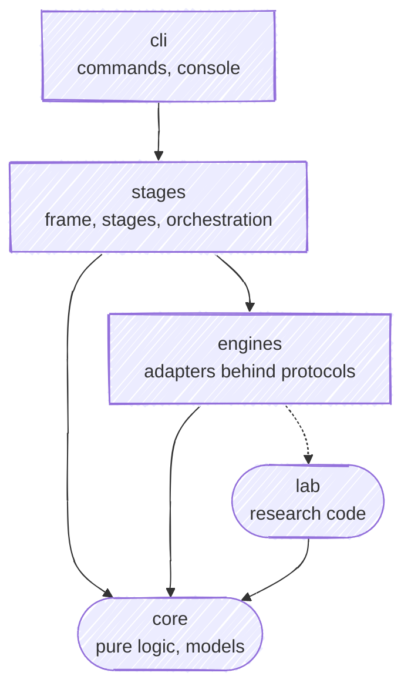
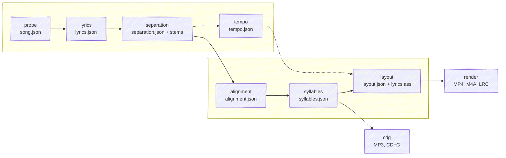

# Architecture

Vocatron is split into four layers, and a fifth package for research code. The import rules
between them are enforced by `import-linter` in `make check`
([ADR-0007](../adr/0007-architecture-and-code-quality.md),
[ADR-0042](../adr/0042-module-map.md)).

| Layer | Contains | May import |
|---|---|---|
| `core` | typed models and pure functions for everything that decides, in one folder per topic | standard library, Pydantic, NumPy; never torch, transformers, subprocess, network or file I/O |
| `lab` | research code that no `vocatron` command runs: the analysis of classic CD+G discs, the evaluation of separation models, the listening test | `core` only, under the same forbidden imports as `core` |
| `engines` | adapters for models, ffmpeg, lyrics lookup, files and the clock, each behind a protocol | `core`, `lab` (the evaluation worker), the engine libraries (lazy imports) |
| `stages` | the frame (`stage`, `batch`, `registry`, `config`, `progress`, `report`), one module per pipeline stage, and the orchestration behind the commands (`songs`, `models`, `profiles`, `doctor`, `bench`) | `core`, engine protocols (`vocatron.engines.protocols`) only |
| `cli` | commands, configuration, console output | `stages`, `core`, and the engines it wires in; never `lab` |

- Engines are chosen at the edge (`cli`) and passed in. Every engine protocol has a fake, so the
  whole pipeline runs on fakes in the fast tests.
- Clock and randomness are injected.
- Heavy imports happen lazily inside engines.
- **Where a protocol lives:** in the lowest layer that calls it. The engine protocols that the
  stages call are in `vocatron.engines.protocols`; the text measurer and the text rasteriser
  (`TextMeasurer`, `TextRasteriser`) are in `vocatron.core.measure`, because the layout in `core`
  calls them and `core` may not import `engines`. Both kinds come with fakes.
- **Topic folders:** a topic with more than one module has a folder in `core` (`lyrics`,
  `separation`, `alignment`, `layout`, `cdg`, `profiles`, `languages`); a topic of one module
  stays a flat module. The stage file of a topic with a folder is `<topic>/file.py`, the
  messages between the stage and its GPU worker are `<topic>/job.py`, and a one-module topic
  keeps its stage file in its module. The fast tests mirror the folders:
  `tests/fast/core/<topic>/test_<module>*.py`.
- **Module names** are one word, or words joined by `_`; `tests/fast/test_module_names.py`
  checks every part against a word list.
- **Research code:** `vocatron.lab` is pure like `core` and holds what only the scripts in
  `tools/` and the tests run: `lab.cdg` (the analysis of classic discs, driven by
  `tools/cdg_analyse.py`) and `lab.separation` (the metrics and the evaluation of separation
  models and the listening test, driven by `tools/separation_eval.py` and
  `tools/listening_test.py`). It has the same gates as `core`: the purity contract, a coverage
  minimum of 95 % and mutation testing on demand. `stages` and `cli` never import it; the
  evaluation worker in `engines` may.
- Models: the registry and the rules that judge a model folder are in `vocatron.core.models`;
  the downloader (urllib3, resumable, checksummed) and the system probe (ffmpeg, PyTorch, GPU)
  are engines with fakes. Stages declare the models they need; `vocatron.stages.models` fetches
  them before the stage runs.
- Lyrics: everything that decides is pure and lives in `vocatron.core.lyrics` (the format of
  [ADR-0008](../adr/0008-lyrics-format.md), cleaning, matching, version choice, the status table, the
  approval rule, the mark of a file Vocatron wrote in `vocatron.core.lyrics.origin`); LRCLIB
  (urllib3) and lingua are engines with fakes, and `vocatron.stages.lyrics` wires them together. Test lyrics are public-domain folk songs only (`tests/fakes/lyrics.py`).

- Separation: the rules (chunk plan, overlap-add, mixing, the headroom rule, the device and
  timeout rules) are pure NumPy in `vocatron.core.separation.rules`; `separation.json` is in
  `vocatron.core.separation.file` and the messages between parent and worker are in
  `vocatron.core.separation.job`. The `Separator` engine
  (`vocatron.engines.separation.process`) starts `python -m vocatron.engines.separation.worker`
  as a child process, waits for it with a timeout, kills it on expiry and turns exit codes into
  `StageError`s; the parent never imports PyTorch. The worker decodes with ffmpeg, caps PyTorch
  at 75 % of the GPU memory, runs both models in half precision and writes the stems. See
  [Copied model code](separation.md). The process handling is shared with the alignment
  (`vocatron.engines.gpu_process` for the parent, `vocatron.engines.gpu_worker` for the worker).
- Alignment: the CTC search, the pieces, the rails check, the estimation and the quality rules are
  pure NumPy in `vocatron.core.alignment` and `vocatron.core.quality`; the languages are modules in
  `vocatron.core.languages` ([Language modules](languages.md)); the acoustic model is an engine
  behind a protocol, with a fake that sings the lyrics. See [Alignment and benchmark](alignment.md).
- Video: the layout is a pure function from syllable times, singers, song info and a style profile to
  a scene (`vocatron.core.layout`, `vocatron.core.scene`); the scene is written as `layout.json` and
  as an ASS file, and the `Renderer` engine (`vocatron.engines.render`) runs ffmpeg with libass and
  `fdkaac` on them. Text is measured in the bundled font by a `TextMeasurer` engine (Pillow). The
  rules of the classic presentation are checked on the scene without rendering. See
  [Layout and video](video.md).
- Batch: `vocatron.stages.batch` runs the songs one after the other and tells a `ProgressSink`
  (`vocatron.stages.progress`) what happens. The `Tracker` is the sink of the command line: it
  turns the events into the estimate of the time left (the pure rules and the learnt speeds are in
  `vocatron.core.progress`), writes `progress.json` of the running song, and hands snapshots to a
  `Display` that the console implements (`vocatron.cli.console`: Rich live lines on a terminal,
  plain lines otherwise). The GPU workers tell their parent how far they are with lines
  `progress <done> <total>` on their standard output (`vocatron.core.worker`, read by
  `vocatron.engines.gpu_process`); the render engine reads ffmpeg's `-progress` output
  (`vocatron.core.ffmpeg_cmd`). Both reach a stage as `StageContext.watch` and an engine request's
  `watch`, which also carries the time left of the song's safety limit; an engine never runs
  longer than that. The child processes run in sessions of their own (one runner for the
  workers and ffmpeg, `vocatron.engines.child`), so Ctrl-C reaches only
  Vocatron (`vocatron.cli.interrupt`): the first sets a `StopFlag` that the batch checks between
  stages, the second raises `KeyboardInterrupt` and the engines kill their child on the way out.
  With `--log` the batch opens the song log with a follower (`FileStore.open_log(path, follow)`):
  every line appended to the file, by the batch or by a GPU worker, reaches the console once, in
  the order of the file (`vocatron.engines.files`; the in-memory fake hands them on at once).
- Report: after the last stage the batch combines the final status with what the stage files say
  into `report.json` (`vocatron.core.report` for the model and the summary lines,
  `vocatron.stages.report` for reading and writing). It is not a registered stage, because a
  stage is skipped when its inputs are unchanged and does not run after a failure, while every
  finished song needs a report, `failed` ones too. A work folder that cannot be written (a full
  disk) fails its song in memory: the report is returned without being stored, and the summary
  names the reason.

## The pipeline and the work folder

A song goes through eight stages, in this order, and each stage reads files of earlier stages
and writes one file of its own into the song's work folder
([ADR-0006](../adr/0006-pipeline-stages-and-files.md)).

The `tempo` stage reads the instrumental stem and has no settings; the layout reads its file to
count the countdowns in beats ([ADR-0022](../adr/0022-countdown-in-beats.md)). The `cdg` stage
runs last and only when `outputs` has `cdg`; it lays the song out again for the CD+G screen
([ADR-0023](../adr/0023-cdg-output.md), [CD+G](cdg.md)).

Every stage file is a Pydantic model with a `schema_version` and a `fingerprint` (the SHA-256 of the
stage's inputs, settings and code version). The batch runner runs a stage only when its
fingerprint changed or one of its products is missing, so a second run on an unchanged folder does
nothing and a fixed lyrics file runs only what depends on it. The committed JSON schemas are in
`schemas/`; a model change bumps `schema_version` and needs a new schema
(see [Adding a stage](adding-a-stage.md)). The files themselves are listed for users in
[Files and folders](../user/folders.md).

Where the code lives, and how it is documented, is in [ADR-0001](../adr/0001-repository-and-documentation-structure.md)
and [ADR-0003](../adr/0003-code-documentation.md). The generated [API reference](api.md) comes from
the docstrings.

## Local tooling files

Editor and assistant configuration of a contributor stays out of git through the clone's own
`.git/info/exclude`, not through `.gitignore` (ADR-0001).
