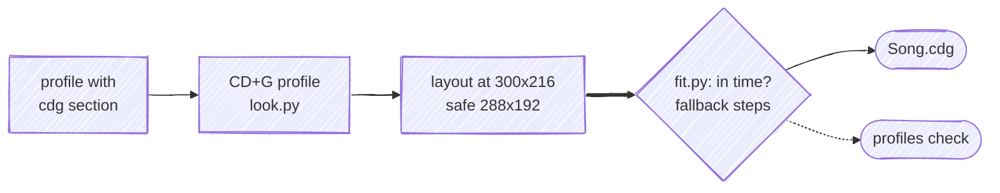

# CD+G: writer, decoder and analysis

CD+G is a stream of 24-byte packets, 300 per second, that draw on a 300 by 216 pixel screen of 16
colours. Vocatron writes it ([ADR-0023](../adr/0023-cdg-output.md)) and decodes it, both in
`vocatron.core.cdg` (pure; NumPy holds the screen). The decoder is the model of the screen the
writer aims at and the oracle of its tests, and it measures classic discs. The sections below
are the writer, then the decoder and the analysis.

## The writer

The `cdg` stage (`vocatron.stages.cdg`, after `render`) turns a song into `Song.cdg` and
`Song.mp3` (or `Song.zip` with both). `Config.outputs` (`[mp4]` by default, `[mp4, cdg]` to switch it on; `mp4` must stay)
decides; when `cdg` is not in it the stage writes `cdg.json` with no files and nothing else, and
its settings leave the profile out so a changed profile re-runs nothing. Its fingerprint has
nothing of the render stage in it, so switching it never renders the video again; while it is on,
it holds `LayoutStage.version`, so a change of the shared layout code that bumps that version
makes the CD+G files again too; so does `Config.cdg_zip`, which is in its settings. The stage lists its products (the pair, or the zip) in `cdg.json`, so a missing one runs it again.



| Piece | Module | What it does |
|---|---|---|
| CD+G profile | `core.cdg.look`, `core.profiles.model.CdgLook` | `cdg_profile(profile, step)` turns the video profile into a normal `Profile` for the CD+G screen: `slots`, `font.size` and `min_size` from `font_px` and `min_font_px` as shares of 192, `edge.width = edge_px / font_px`, no shadow offset, no fade, every colour rounded to 12 bits (`core.colour.round_12bit`) or overridden (`#rgb` or `#rrggbb`, `long_hex`), and for a fallback step a raised `lead_in`. It goes through `Profile` validation again. The unchanged layout, rasteriser and scheduler do the rest, so no look has code of its own ([ADR-0029](../adr/0029-cdg-section-of-a-style-profile.md)). |
| Timing and fallback | `core.cdg.fit` | `fit_stream(phrases, song, profile, measurer, rasteriser)` writes the song at the first of `fit_steps(profile)` that is in time, or at the last one with `Fit.in_time` false. See below. The stage and the check both call it. |
| Layout | `core.cdg.canvas`, `core.layout.build` | `cdg_scene` lays the song out with the video's pure layout on `FRAME` (300×216) with `SAFE` (the visible 288×192, one tile inside the border) as the safe area. `layout(..., safe=)` takes the area instead of the profile's share. `stages.layout.prepare_layout` loads the profile and the stage files for both stages. |
| Palette | `core.cdg.palette` | 12-bit colours, at most 16 entries (`cdg-palette` names them otherwise), see below. `build_title_palette` is the start screen's own palette, see "The start screen". |
| Rasteriser | `core.measure.TextRasteriser`, `engines.raster` | Draws the text of an element as a map of coverage, sized as libass sizes it (`em_per_cell`, the ascent from `ascent_share`), so the letters have the width the layout measured. The fake in `tests/fakes/raster.py` draws one box per letter. |
| Target frames | `core.cdg.raster` | Every element becomes an *art* that knows its state at a time and paints itself. Text is drawn once from the coverage as ink (from 128), one shade level (from 48) and the edge (the dilation of the letters by `max(1, round(edge))` pixels, drawn only when its colour differs from the background); shadows are dropped and fades are cuts. The wipe moves in steps of `TargetFrames(..., step)` pixels (the look's `wipe_columns`; `STEP` = 3 is the default); bars and countdowns step the same way. The timer of a break screen (`TimerElement`) is a `TimerArt`: each number from 1 to its total is drawn once, centred in the timer's box, its state is the seconds left, so a frame is drawn again once a second and only the timer's tiles change; its colour is a text colour of the palette. `TargetFrames.frame(tick)` is the frame at `tick / 100` s (the same array while nothing changes); everything is clipped to the safe area. |
| Packets | `core.cdg.write` | Builders of the 24-byte packets, the inverse of `packet.py`: memory and border preset (with repeat count), the two colour table loads, tile block normal and XOR; parity bytes are zero. |
| Tile encoder | `core.cdg.encode` | `plan_tile(current, target)`: one XOR block when the difference has one value besides 0 (a wipe step, a XOR erase) or two values and no 0; one normal block when the target has one or two colours (an erase is one packet); otherwise the shorter of XOR blocks only (per value or per bit plane) and a normal block of the two most frequent colours followed by XOR blocks. |
| Scheduler | `core.cdg.schedule` | Models the screen with `CdgScreen`. Every tick (three slots) the tiles that differ from the last target are queued with their due tick (a queued tile keeps its place and is encoded from the newest target when sent); every slot sends the next packet of the oldest tile. Two queues, `WIPE` (wipes, bars, countdowns) before `DRAW` (the tiles of lines that appear or go, which have the lead-in to be drawn in). For a page look (`schedule(..., clear_first=True)`, set by `fit.write_step` from `profile.mode == "page"`; line looks keep the direct redraw and their bytes) there is a third queue `CLEAR` between them: a tile of a line that appears or goes joins `CLEAR`; when it is served, a tile that shows anything but the background is filled with the background (one packet) and moves on to `DRAW`, a blank one moves on at once, and a tile that only has to go is done with the clearing. So all changing tiles of a change are cleared before the first is drawn, and a page builds from the top (ADR-0041); no tile of a page ever shows old and new text together. A tile waiting in `WIPE` that is redrawn moves to `CLEAR`. Returns the stream, the longest waits of both queues, the ticks at which the screen showed the whole target (`settled`) and the *deadlines* it missed (`missed`): `TargetFrames.deadlines` holds the pixels of every lyric line and the tick of its first syllable, and the scheduler compares its model screen at that tick with the target of `max(tick - 1, shown)`, `Deadline.shown` being the tick the line first appears: a line that appears at the tick it is sung is compared with itself and fails until it is drawn (ADR-0041). |
| Stream | `core.cdg.stream` | `build_stream(scene, rasteriser, wipe_columns)`: the header (colour table, memory preset ×8 with repeat counts 0 to 7, border preset ×2; the start screen's colour table when the scene has a pixel wordmark), then the scheduler's slots up to the scene's duration, a whole number of packets. With a start screen it also hands the scheduler a `Swap`, see "The start screen". |
| Zip | `core.cdg.pack`, `engines.pack.ZipPacker` | `pair_names`, `zip_name` and `ZIP_TIME` (1980-01-01, the earliest a zip holds) decide the members, their order (MP3, then CD+G) and the time; the `Packer` protocol writes it (`PackRequest`), deflated at level 9 with a fixed `create_system` and file mode, to `Song.zip.part` and renamed, so the same members give the same bytes ([ADR-0030](../adr/0030-mp3g-zip.md)). With `cdg_zip` the MP3 is encoded into the work folder and only the zip goes to the output folder. The fake in `tests/fakes/pack.py` records the request and writes a listing. |
| MP3 | `core.ffmpeg_cmd.mp3_command`, `engines.render.FfmpegRenderer.encode_mp3` | LAME through ffmpeg ([ADR-0024](../adr/0024-mp3-for-cdg.md)): the karaoke stem with `delay_args(scene.lead)`, `-b:a 192k -ar 44100 -ac 2`, written tag-less (`-map_metadata -1 -id3v2_version 0`) to `Song.part.mp3`. ffmpeg cannot write the standard `COMM` comment frame, so `core.id3.id3_tag` builds the whole ID3v2.4 tag from `core.song.media_tags` (`TIT2`, `TPE1` when there is an artist, `TCON`, `COMM` in English with an empty description, UTF-8, plus a `TXXX` frame with the description `TAG` for `Duet` to `Quintet`, no padding) and `encode_mp3` writes it and then the audio bytes to `Song.tagged.mp3`, which replaces the target; the partial files are removed on any error ([ADR-0035](../adr/0035-the-id3-tag-of-the-mp3.md), [ADR-0047](../adr/0047-vocatron-writes-the-tags-of-every-output.md), [ADR-0031](../adr/0031-artist-and-title-tags-in-the-outputs.md)). The fake writes the same tag. Behind the small `Mp3Encoder` protocol with a fake. An ffmpeg without libmp3lame gives `missing-tool`. |

`FileStore.write_bytes` (atomic like `write_text`) writes the `.cdg`.

### The palette rule

The 16 entries are eight pairs: ink at an even index, its shade (half way to the background) at
the next. Flat colours (the background at index 0, an edge that differs from it, bars) fill the
first pairs two to a pair; every text colour of the scene (unsung and sung colours of the lines
and their turns, preview and card text, and the timer of a break screen) has a pair after them. A colour group is an unsung and a
sung colour; its mask is `ink_unsung ^ ink_sung`, which is also `shade_unsung ^ shade_sung`, so a
wipe step is one XOR packet that touches ink and shade alike. Every classic built-in look uses one pair for
the unsung colour, six for the five singers and the group, and one for the background and the edge: exactly eight (`tall-page` has one unsung colour, cyan, and six sung ones; `three-line` has orange and white, and five more colours, one of them the group's, which the timer is drawn in).
More colours than that is `cdg-palette`; a look can relieve it by giving colours of two singers one 12-bit value (`cdg.colours`). The rounding itself lives in `core.colour` and is the rule of `cdg_profile` too.

### The start screen

[ADR-0056](../adr/0056-the-cdg-start-screen-has-its-own-palette.md). `cdg_scene` lays the song out
with `layout(..., pixel_mark=True)`: with `title.form: wordmark` the title card gets a `TitleMark`
with `pixel: true` (`layout.json` v14), `scale` 3 (the pixels along a cell's side), no build-up,
the frame at `PIXEL_FRAME_WIDTH` by `PIXEL_FRAME_HEIGHT` of the safe area (`layout.mark`), a rule
two pixels high and the texts without an outline (their outline colour is the field). A start
screen shorter than `BUILD_MIN` (four seconds) gets the plain card instead, in the look's
colours and not in capitals; the break and end screens are always the plain card (`Context.names`).
Rule 14 checks the pixel mark (no build-up, at least four seconds). The texts of this screen have
sizes of their own in pixels, the same in every look (`PIXEL_TITLE_PX` 22, `PIXEL_ARTIST_PX` 15,
`PIXEL_NAME_PX` 13 in `layout.mark`; `Context._scale` turns them into shares of the base size), and
`wordmark_card` returns `None` when a laid-out text is smaller than `PIXEL_FLOOR_PX` (12):
`Context.title_card` then builds the plain card, which has no mark and so no title palette.
`cdg.min_font_px` plays no part. The video has no floor; its sizes stay relative to the base size.
Wrapping and the names' arrangement are the same in both (see the video's start screen).

The pixel letters are `core.wordmark.PIXEL_LETTERS` (rows of `X` and `.`), set in `pixel_word_cells`
with one cell between letters and banded by `pixel_band`; `tests/fast/core/test_wordmark.py` checks
each against its polygon letter (at least 85 % of the cells agree). `core.cdg.raster` draws the
screen as arts: the letters with a one-pixel edge (`with_edge`), the frame as a one-pixel rounded
outline, the rule, the texts. The texts are ink only (`ink_only`, from coverage 96), because the
palette has no shade entries.

`build_title_palette(scene)` returns `None` without a pixel title, else a `Palette` with
`shaded=False`: entry 0 the field, then the cyan, the seven bands (amber is the second), white, then
one entry per name colour, each once. `build_palette` skips the pixel title card, so the song's
palette is what it would be without it. `build_stream` loads the title palette in the header and
passes `Swap(tick, packets)` to `schedule`; the tick is `TargetFrames.swap_tick`, the first tick
after the title. At that tick the scheduler drops what still waits, sends a memory preset in
index 0 and the song's two colour table loads, sets its model screen and its current frame to the
cleared state and goes on, so the song's tiles are queued after the swap. The tiles of the start
screen do not count into `draw_lag` or `wipe_lag`. The screen is drawn as fast as the format
allows and settles within three seconds, well before the screen ends (tests assert it on the
scheduler, with the fake rasteriser and with the real font, a long title, a long artist and five
singers in every CD+G look; such a screen takes about 2.1 s); there is no timed
build-up. `decode` returns the palette in force at each snapshot (`CdgDecoding.palettes`) and
`rgb_frames` uses it, so a picture of the start screen has its own colours.

### The look's `cdg` section, the fallback and the check

`Profile.cdg: CdgLook | None` ([ADR-0029](../adr/0029-cdg-section-of-a-style-profile.md)). The
marker is `made_for_cdg(profile)`; the `cdg` stage raises `cdg-not-made-for-cdg` when it is false.
A rule the section breaks (`cdg.slots` below `page.min_lines`, a preview with more than one slot)
is found by `slot_conflicts`, the same function the video's `slots` goes through, and reported at
`cdg.slots` by `parse_profile`, with a hint what to do (`CDG_SLOTS_HINT`); a section without the
marker is not checked against them. `core.cdg.look.fit_steps` gives the fallback steps: as declared; for a page look
that turns whole pages the same with `page.turn: line` (`FitStep.page_turn`, "line by line"; the later
steps keep it; `cdg_profile` sets it; ADR-0041); the
lead-in minimum raised to the look's target; to its maximum; the wipe at 6 pixels. A step that
repeats the one before it is left out. A step is *in time* when no deadline is missed and the
wipe lag is at most `MAX_WIPE_LAG` (50 ms). Raising the lead-in minimum helps lines that appear
late because their slot is refilled late (`clear.replace_after`); a page look that turns whole pages cannot appear earlier
than the page before it is gone, which is why its first step is the line turn (`core.layout.pages`,
`place_pages` with `page.turn: line`: the line of the next page for a slot appears when the line in
it has been sung; rule 10 and rule 9 check it). A song that is not in time after the last step gets
`CdgFile.reasons`: "CD+G not in time: N lines drawn late, wipe X ms behind" (status `review`).

`core.cdg.check.check_cdg` is the CD+G part of `vocatron profiles check` (called by
`core.profiles.check.check_profile`, which also gets a rasteriser for it): the sample songs,
`sample.dense_piece()` (sixteen invented lines half a second apart, all five singers and the
group, a countdown and a break) and `sample.back_to_back_piece()` (the same lines with no pause
longer than half a second, so pages follow each other at once) are laid out for CD+G and written with `fit_stream`. Palette
errors, contrast on the 12-bit colours, `too-wide` and `block` shortfalls and the timing after the
last step are issues at `cdg.colours`, `cdg.colours.<singer>.<part>`, `cdg.min_font_px`,
`cdg.slots`, `cdg.font_px` and `cdg.wipe_columns`; a broken scene rule has no key. The check takes
about two seconds a look with the real font. It must use the real font: the fakes draw other
shapes, and the timing depends on them (`tests/conformance/profile_kit.py` uses the real font).

The built-in values were settled by that check: 24 pixels (18 at the smallest) for one to four
slots, 23 (18) for the six rows of `tall-page` (24 does not draw the dense song in time), 36 (24) for
the three lines of `three-line`, 20 (18) for the five lines of `full-page`, and 20 (16) for the two rows of
`one-line-preview`, whose lines are replaced whole and need the time (24 pixels does not draw a
two-row line in the 0.4 s of the sample's short gap).

### What the scheduler promises

By construction it never writes more than one packet per slot, and `Scheduled.settled` says when
the screen is complete. The tests on the folk-song fixtures decode the stream back and check that
at those ticks the decoded frame equals the target frame, that every line is complete before its
first syllable, that no ink column the wipe passed 6 pixels or 50 ms ago is still unsung, and that
nothing is drawn in the border. `cdg.json` records the longest wait of each queue (`draw_lag`,
`wipe_lag`).

### Tests

| Test | Stage | What |
|---|---|---|
| `core/cdg/test_write.py` | 1 | Every builder against the decoder and the hand-built packets; random tiles decode back exactly. |
| `core/cdg/test_palette.py` | 1 | 12 bits, the 16 limit, the XOR rule for ink and shade of six colour groups. |
| `core/cdg/test_look.py` | 1 | The CD+G profile: pixel sizes as shares, no shadow, no fade, rounding and overrides, the fallback steps. |
| `core/cdg/test_raster.py` | 1 | Ink inside the boxes, the wipe in steps (1, 2, 3 and 6 pixels), per span and per turn, the edge rule, bars and dots. |
| `core/cdg/test_schedule.py` | 1 | One packet per slot, the queues, a tile queued once, the lags, the settled ticks, the deadlines. |
| `core/cdg/test_fit.py` | 1 | A song in time takes step 0, a late one a later step, none the last step with the flag; same input, same bytes. |
| `core/cdg/test_title_screen.py` | 1 | The start screen: the title palette (order, sharing, five singers and a group, more than 16 refused), the song's palette without its colours, text in ink only, the frame's outline, the stream decoded: palette, every pixel of the letters, the amber rule, the swap packets, nothing drawn between, drawn within three seconds (also in the real font with a wrapped title and artist, three names and five names and a group, every CD+G look), the sizes of every look equal and none below the floor, the wrapped rows of one size, the names side by side, the plain card for texts under the floor in the real font, the plain card of a short screen, `title.form: plain` byte for byte the golden stream of the plain card. |
| `core/cdg/test_stream.py` | 1 | The round trip of every classic built-in look on the folk-song fixtures (a single voice, a duet, a duet with turns) with the real font: drawn before sung, the wipe within 6 px or 50 ms, nothing outside the safe area. |
| `core/cdg/test_golden.py` | 1 | Golden pictures (`tests/data/cdg/<look>/`) of the four moments of every look (title, a line being sung, a line or page change, the countdown), drawn in the real font, and one more of a feature the four do not show: a line wrapped onto two rows over two slots (`tall-page/wrapped.png`) and the timer of a break screen (`three-line/timer.png`). `VOCATRON_UPDATE_GOLDEN=1` writes them again; look at them first. |
| `core/cdg/test_pack.py`, `engines/test_pack.py` | 1 | The members and their order; the same bytes twice, fixed times, no partial file. |
| `core/profiles/test_check.py`, `core/profiles/test_model_conformance.py` | 1 | Every classic built-in look passes the check with the CD+G part, every video-only look the check without it; a broken fixture fails each part at its key; an MP4-only look is skipped. |
| `test_cdg_stage.py` | 1 | The stage on fakes: on and off, no new video, products, collision, `cdg-palette`, `cdg-not-made-for-cdg`, the fallback and its warning, the zip. |
| `tests/slow/test_cdg_real.py` | 2 | ffmpeg's `cdgraphics` decoder shows the same RGB frames as ours for every classic built-in look; the real MP3 is LAME, 192 kbit/s, 44.1 kHz stereo and within 50 ms of the scene's duration, and ffprobe reads its title, artist, genre, comment and `TAG` with the raw frames `COMM` present and exactly one `TXXX`. |
| `tests/slow/test_cdg_js.py` | 2 | The same with cdgraphics (JavaScript) run unchanged by Node ([ADR-0025](../adr/0025-cdgraphics-as-a-test-decoder.md)). |

`make profile-pictures` also draws a CD+G sheet per look (`docs/assets/profiles/<name>-cdg.png`):
`core.cdg.picture.cdg_picture` writes the picture song and decodes the six moments of
`core.profiles.picture.picture_moments`, each moved to the next tick at which the screen is
settled. The golden frames and the sheets come from that one function. The manifest digest of a
sheet covers its inputs (the CD+G profile, the whole scene with the singers and colours of the
lines, the moments, the font) and not its pixels, as for the video sheets; the video digest leaves
the `cdg` section out, so a change of CD+G values does not make a video picture stale.

`make cdg-js` fetches the one tarball `cdgraphics-7.0.0.tgz` from the npm registry into
`.tools/cdgraphics-7.0.0/` and checks it against the integrity value pinned in the `Makefile`; it
runs no `npm install` and nothing of it enters git. `tests/slow/cdg_frames.mjs` (ours) defines the
`ImageData` class the library expects, imports the library as it is and writes raw frames. Without
Node 20 or newer or without the folder the test is skipped with the reason. The decoders agree at
every packet boundary, which a mistake in reading the format that writer and decoder share could
not survive.

### Adding a look to CD+G

A classic look gets a `cdg` section with `made_for_cdg: true` and values that pass the check
(`vocatron profiles check`, `tests/fast/core/profiles/test_model_conformance.py`, which runs it with the
real font); a look for the video only leaves the section out. Choose the values by running the
check: it names the key to change. A new built-in look is also a golden frame set
(`VOCATRON_UPDATE_GOLDEN=1 pytest tests/fast/core/cdg/test_golden.py`, then look at the pictures)
and a CD+G sheet (`make profile-pictures`); the parametrised tests pick it up from
`BUILTIN_PROFILES`.

## The decoder and the analysis

The decoder is part of `core`; the analysis of classic discs is research code in `vocatron.lab.cdg`
(no `vocatron` command runs it; `tools/cdg_analyse.py` drives it, [ADR-0042](../adr/0042-module-map.md)).

| Piece | Module | What it does |
|---|---|---|
| Packets | `vocatron.core.cdg.packet` | Parses 24-byte packets; other commands and trailing bytes are skipped, the index keeps the time (`index / 300`). Parity is ignored. |
| Screen | `vocatron.core.cdg.screen` | `CdgScreen.apply(packet)` for memory and border preset, tile block normal and XOR, scroll preset and copy, transparent colour and the two colour table loads. Its module docstring fixes the details that players handle differently (repeats, fine scroll offset, tiles outside the grid). |
| Decoder | `vocatron.core.cdg.decode` | `decode(stream, snapshots)` returns the timeline of `CdgEvent`s and the frames (palette indices) at the requested times. |
| Tracking | `vocatron.lab.cdg.tracking` | Follows the tiles with their pixels: the lifetime of the text in each tile row (a *session*), its wipe samples, how it went (cleared, replaced, preset, scrolled). An XOR tile is judged by its result: no ink left = erase, ink on an empty tile = draw, the set of ink pixels changes = compose (outline fonts), same ink with new colours = wipe sample, except an XOR on the tile drawn or composed by the tile packet just before (at most `LAYER_PACKETS` later), which is one more layer of smoothed text drawn in bit planes. Apart from that no timing is involved, so a wipe may start right after the draw. Rules and limits are in its docstring. |
| Tile map | `vocatron.lab.cdg.tile_map` | A map of a frame at tile resolution (50 by 18 characters, no pixel of a tile survives) that shows where lines stand and in which palette colour, never what they say. |
| Analysis | `vocatron.lab.cdg.analysis` | Numbers only: title phase, lines per screen and their tile rows (where each line was wiped), alignment, lead-in, wipe speed, step and sample advance (the granularity), hold, gaps and breaks with countdowns, palette, colours per singer. Its rules (line, title, step, speed, granularity, gap, countdown, alignment) are in its module docstring. |
| Report | `vocatron.lab.cdg.report` | The text blocks per song and per vendor. |

## The analysis tool

`tools/cdg_analyse.py [FOLDER]` (default `.corpus/cdg`) reads the `.cdg` files in the vendor
subfolders, takes the song length from an audio file of the same name next to it when there is
one, and prints and writes (`FOLDER/report.txt`) the blocks per song and per vendor. It prints
numbers and file names only, never lyrics, and never writes a frame as an image: a tile is a
position, a pixel count and two colours. The discs stay in `.corpus/` and never enter git.

```text
uv run --no-sync python tools/cdg_analyse.py .corpus/cdg
```

## Thresholds (tuned on seven real discs, checked on 25 discs of 8 vendors)

All are constants with a docstring in the module that uses them.

| Constant | Value | Module | Meaning |
|---|---|---|---|
| `LAYER_PACKETS` | 2 | tracking | An XOR on a tile at most this many packets after the packet that drew or composed it is a layer of the drawing, not a wipe (smoothed text in bit planes; on the real discs nearly every layer comes in the very next packet). |
| `DRAW_GAP` | 0.5 s | tracking | A draw in a row after this much silence starts a new session; an XOR with the running wipe's colour over a tile with no text within this time of a sample is the highlight running on. It does not separate composing from wiping (the pixels do). |
| `TICK_WIDTH_TOLERANCE` | 1 column | analysis | Ticks of one countdown have the same width (the dots or blocks are alike). |
| `COUNTDOWN_MAX_BEFORE_WIPE` | 3.0 s | analysis | The last tick of a countdown comes at most this long before the wipe it counts in; regular changes further away are something else. |
| `BAR_MIN_SECONDS`, `BAR_PACE_TOLERANCE` | 6.0 s, 0.1 | analysis | A highlight that moves at an even pace (every step within 10 % of the median spacing) for 6 s or more is a progress bar that fills a break, not a sung line (the bars seen ran 8.5 to 45 s; even sung lines at most 5.0 s). The gap reports how long its bar ran. |
| `WIPE_MIN_COVER`, `WIPE_MIN_SPEED` | 0.75, 3 px/s | analysis | A highlight that crosses no more than three quarters of its line, or crawls slower than 3 px/s, is an animation or a picture drawn in XOR layers, not a sung line (sung lines: 0.87 and up, 5 px/s and up; animations 0.6 at most, pictures 2 px/s at most). A line that changes colour in a single step (`STEP_GAP`) is not sung either: a fade or flash of the whole text, a blinking mark (a seconds timer in a notice) or a bit of ink that did not join its line (the shortest sung lines take 0.07 s in two steps). |
| `WIPE_RESTART_PIXELS` | 4 tiles | analysis | A row shared by two lines (descenders of one, ascenders of the next) is wiped twice; where the highlight jumps back this far, a new pass begins and each pass joins its own line, as wide as the part its highlight crossed. |
| `WIPE_JOIN_SLACK`, `WIPE_JOIN_PIXELS` | 3.5 packets, 2 tiles | analysis | A session wiped in one step joins the line in the next row when their wipes are up to three packets apart and it lies where that line's highlight was at the time, within two tiles (the disc sends the tiles of one column row after row; such tiles are a few pixels off, while a descender at the far end of the line above is 100 pixels and more away from where the next line starts). |
| `COUNTDOWN_MIN_TICKS`, `COUNTDOWN_MAX_COLUMNS`, `TICK_*` spacing | 3, 8, 0.3 to 3.0 s | analysis | They also apply to blocks that are drawn together and highlighted one after the other (wipe samples in at least three separate bursts), which are then no lyric line. |

How the real discs draw: most of them draw, highlight and erase with XOR tiles only (the
colour of the XOR is the difference between the colours before and after: draw = background
xor unsung, wipe = unsung xor sung, erase = sung xor background), so the background colour of
the last memory preset (not always 0) must be known to read the unsung and sung colours.

## Looking at a layout without the lyrics

`tools/cdg_analyse.py FOLDER --tilemap NAME --at 3,10,20` (or `--timeline START,END,STEP`)
prints tile maps of the first disc whose path contains NAME: `.` background, a lower case
letter a flat tile in that palette index (a = 0), an upper case letter a tile with ink in the
colour of that index. Never write frames of the discs as images.

## Tests

Stage 1 builds discs from packets (`tests/fakes/cdg.py`: `CdgBuilder` and a synthetic 50-second
`classic_song()` with a title, three lines, a break with a countdown and a second singer) and
checks every instruction, XOR wipes, scrolls, palette loads, the analysis numbers of the
synthetic disc (with golden files for its timeline, its analysis and its report), the hard
cases (outline fonts composed by XOR, recolour wipes, lines two rows high, smooth wipes, page
and line mode, scrolling discs, duets, lines sung together, countdowns and what is no
countdown), and properties (arbitrary bytes never fail, decoding is deterministic, XOR twice
restores, a preset clears). Stage 2 (`tests/slow/test_cdg_corpus.py`) decodes and analyses the
real discs for robustness and skips while there are none.
