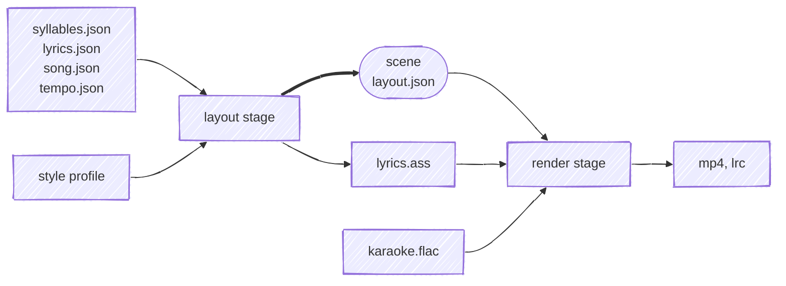

# Layout and video

The video is made in two stages that share one pure model, the scene
([ADR-0009](../adr/0009-style-profiles-and-output-presets.md)).

| Piece | Module | What it does |
|---|---|---|
| Profile | `vocatron.core.profiles.model` | The YAML schema, loading with `file:line:column` errors, overrides, the contrast rules. |
| Presets | `vocatron.core.presets` | Frame size, codec and quality; the audio settings and their defaults. |
| Scene | `vocatron.core.scene` | Screens with timed elements; `Scene.visible_at(t)`, `LineElement.wipe_front(t)`. |
| Layout | `vocatron.core.layout` | `phrases` (lines and their singers, `shifted`), `intro` (the silent intro), `fit` (split and shrink), `place` (slots and times in line mode), `pages` (page mode: cutting and times), `cards` (title, break, end, countdown, progress bar, timer), `mark` (the start and end screens with the wordmark, the break screen's symbol), `build` (everything). |
| Measuring | `vocatron.core.measure`, `vocatron.engines.measure` | The `TextMeasurer` protocol; Pillow measures the bundled font. |
| ASS | `vocatron.core.ass` | `write` writes the scene as ASS, `mark` draws the wordmark screens and the V symbol, `tags` holds the small pieces both writers share, `parse` reads it back for the tests, `timing` holds the centisecond helpers. |
| Wordmark | `vocatron.core.wordmark`, `vocatron.core.logo` | The letters of the wordmark and the V symbol as polygons with their colours, and the SVG text of the logo files made from the same polygons ([ADR-0055](../adr/0055-the-start-screen-carries-the-wordmark.md)). |
| LRC | `vocatron.core.lrc` | The enhanced LRC, on the writer of ADR-0008. |
| Commands | `vocatron.core.ffmpeg_cmd` | The ffmpeg and fdkaac command lines as pure functions. |
| Tags | `vocatron.core.song.media_tags`, `core.lyrics.file.ensemble_word`, `core.mp4_tags`, `FfmpegRenderer._write_tags` | The tags of the MP4 and the MP3 ([ADR-0031](../adr/0031-artist-and-title-tags-in-the-outputs.md), [ADR-0047](../adr/0047-vocatron-writes-the-tags-of-every-output.md)): title, artist (not without one), genre `Karaoke`, a fixed comment, from `song.json`, then `tag` = `Duet` to `Quintet` from `lyrics.json` (the number of different single singer numbers in the lines and their turns; `all` and groups add none; fewer than two or more than five give none). ffmpeg writes none (`-map_metadata -1`, no `-metadata`). After it, the engine finds `moov` in the partial MP4 (`locate_moov`; a `moov` after `mdat` is an error), `retag_moov` replaces its `udta` with `udta/meta(hdlr mdir)/ilst` (`©nam`, `©ART`, `©gen`, `©cmt`, freeform `----:com.apple.iTunes:TAG`, UTF-8 `data` atoms) and moves every `stco`/`co64` offset by the change in size, since fast start puts `moov` before the media; the rest of the file is copied unchanged into `.tagged.mp4`, which replaces the partial file. `read_tags` reads the atoms back for the tests. The render and MP3 requests carry the tags (`tags`), the stages fill them. The MP3's tag is written by `core.id3` ([ADR-0035](../adr/0035-the-id3-tag-of-the-mp3.md)). |
| Renderer | `vocatron.engines.render` | Runs them; `FakeRenderer` in `tests/fakes` records the request. |

## The scene

A scene knows the frame, the safe area, the slots, the preview row (if the profile has a
preview), the look (wipe, shadow, font) and a list of elements ordered by start: `LineElement` (a
lyric line in a slot, with the place and time of every syllable and, in page mode, its page),
`PreviewElement` (the next line, smaller, below the slots), `ProgressElement` (the bar of a break
screen), `CountdownElement`, and `CardElement` (title, break and end screens). Every
element has a `start`, an `end` and a `box`, and the tests ask only the model. The scene is
written as `layout.json`; the CD+G output draws the same scene, laid out again for its own screen (see [CD+G](cdg.md)). What the layout could not
do as the profile asks (a lead-in shorter than the minimum, a shortened title) is a `Shortfall`
in the scene and a line in the song log, not an error.

Sizes are pixels of the frame. A profile's sizes are shares: the font size is a share of the
height of the safe area, and it is the height of a line cell, which is what an ASS `Fontsize`
is. Edge and shadow are shares of the font size.

## The countdown in beats

[ADR-0022](../adr/0022-countdown-in-beats.md). The `tempo` stage (`vocatron.stages.tempo`) reads
`stems/instrumental.flac` through the `AudioReader` engine (ffmpeg, mono, 22.05 kHz) and writes
`tempo.json` (`TempoFile`: `bpm`, which is `None` when the tempo is unclear, and `clarity`). The
estimate is `vocatron.core.tempo.estimate_tempo`, NumPy only: the onset strength (the rise of the
log-magnitude spectrum, frames of 1024 samples every 256), its autocorrelation over 40 to 240 BPM
weighted gently towards 120 BPM, the strongest peak refined with a parabola. `clarity` is the
height of that peak above the median of the autocorrelation; below `MIN_CLARITY` (or in a song
under `MIN_SECONDS`) the tempo is unclear. One tempo per song, no beat positions. Its constants
are named in the module and the property tests run on synthetic drum patterns
(`tests/fakes/clicks.py`).

`SongText.bpm` carries it into the layout. `countdown_beat(bpm, count)` doubles or halves the beat
until `count` beats last between `MIN_COUNTDOWN` (1.5 s) and `MAX_COUNTDOWN` (4 s).
`build.countdown_window` then puts the countdown before the line: it ends at
`tempo.countdown_end`, one beat before `sing_start` (ADR-0028), and lasts `count` beats; if the
line before, the title or the break screen (`floor`, the latest of their
ends, ADR-0026) leaves less room, it starts on the first whole beat after the floor and counts
the beats that are left; with less than one beat there is no countdown. Without a tempo it runs
over `countdown.duration` seconds up to `sing_start`, cut at the floor. Rules 11 and 13 find the
line a countdown counts in by the same `countdown_end`. A
`CountdownElement` with a `beat` counts beats (`count` is then the number of beats it lasts); one
with `beat = None` counts seconds. `core/ass/write.py` needs no change: the dots go out evenly over the span.

The scene carries the tempo too (`Scene.bpm`), so rule 13 knows which case it checks. Without a
tempo: seconds up to `countdown.duration`, and a countdown wherever there is room. In both cases
the countdown does not start before the line before, the title or the break screen ends. With a
tempo the beat is `countdown_beat(Scene.bpm, count)`, the countdown lasts a whole number of those
beats up to `countdown.count`, ends a beat before the line, and has fewer beats than `count`
only when less than a beat is left over; a line has no countdown only when less than one beat of room is left. The sample songs
(`layout.sample`) have a tempo of `SAMPLE_BPM` (100), so the pictures of the looks show a
countdown in beats.
`report.json` (schema 2) has a `countdown` note, `{"tempo": 101.4, "unit": "beats"}` or
`{"tempo": null, "unit": "seconds"}`; an unclear tempo is not a reason for review.

## The silent intro

[ADR-0020](../adr/0020-a-silent-intro-before-the-song.md). The layout decides the amount once:
`intro_lead(first_start, ensemble, profile)` is `max(0, minimum - first_start)` rounded to a
thousandth, with the profile's `intro.solo` or, for a song with more than one singer or any `all`,
group line or turn (`phrases.is_ensemble`), `intro.group`. `build.layout` shifts the phrases by it
(`phrases.shifted`) before anything is placed, so the title window, the placement, the countdowns
and the end screen need no special case, and stores it as `Scene.lead`. Every time in the scene
(and so in `lyrics.ass`) already includes it, and `Scene.duration` is the song's length plus the
lead. Rule 19 checks that the first word is at or after the minimum and the lead is what was
missing.

The render stage applies the lead to what the scene does not draw: `RenderRequest.lead` makes the
renderer put `adelay` (milliseconds, all channels) in the decoding step of the audio, so the
M4A, and the MP4 that copies it, start with silence (`delay_args`; nothing is added at 0, so a song
without an intro keeps its commands). The FLAC export is copied at lead 0 and encoded again with
the delay otherwise (`flac_export_command`). `enhanced_lrc(offset=lead)` shifts the tags and the
`length` of the `.lrc`. The stems, `lyrics.json`, `syllables.json` and the user's lyrics file are
never shifted.

The export is off by default (`audio.export: none`, ADR-0048). When the render stage runs,
`delete_stale_exports` deletes a `.m4a` or `.flac` that the previous `render.json` lists and the new
run does not make, and nothing else: only plain names (no folder part) in the output folder, never
a file named like the song's own audio or lyrics file (an old export in a song folder used as output
folder can have become a song; names, not paths, are compared, because a symlink or `..` can make
two paths one file, so such an export is left in any output folder), names compared without case,
and a file that cannot be deleted is logged and left.
The work folder, and so `render.json`, lies inside the output folder, so another `--output` reads
only the `render.json` of runs into that folder.

## The start screen with the wordmark

`title.form: wordmark` (the default, [ADR-0055](../adr/0055-the-start-screen-carries-the-wordmark.md))
gives the title `CardElement` a `mark` (`TitleMark`, `layout.json` v13): the field colour, the box
and `scale` of the wordmark, the box of the rounded frame and its radius, the short rule and the
build-up as times (`BuildUp`: the edge fading in, the three fills with their letter ranges, the
wipe of frame and texts). The card keeps its kind and its lines, so everything that looks for the
title card still works; with a mark its `box` holds the wordmark and the frame, and the lines are
capitals laid out by `card` inside the frame (`vocatron.core.layout.mark.wordmark_card`), the title
white, the artist amber, the singers in their colours. A title or artist (`CardText.wraps`) that is wider than the frame's inside is wrapped onto two rows at a word
first (`fit.wrap_words`, the same split as for a sung line): the second row is `CardText.tight`, so
`card` gives both rows one size (the smaller of what each needs) and puts them `ROW_PITCH` font
sizes apart instead of `LINE_PITCH`. The singers' names and the group (`CardText.flows`) are
arranged by `mark._best`: the card is laid out with the names spread evenly over every row count
(`mark._flowed`; `CardText.join` puts a name on the row of the one before it), and the count that
leaves the names largest once shrunk to the width and the height wins, then the one with the
largest smallest text, then the fewest rows. The rule stands in a spacer line `card` lays out
between title and artist, after the last row of the title. The build-up exists only for a screen of at least `BUILD_MIN`
(four) seconds; the step times are constants of that module. `plain` has no mark. The CD+G scene
has the mark with `pixel: true` and no build-up (`layout(..., pixel_mark=True)`, `layout.json` v14;
[ADR-0056](../adr/0056-the-cdg-start-screen-has-its-own-palette.md), see [CD+G](cdg.md)). Rule 14 checks the mark: lines and
rule inside the frame, build-up inside the title window and present exactly from four seconds, and
rule 1 checks the boxes of wordmark and frame against the safe area.

### The end and break screens

[ADR-0057](../adr/0057-the-end-and-break-screens-carry-the-mark.md): `title.form` switches all
three screens of the video, and the CD+G scene keeps its end and break screens plain
(`Context.marked` is `wordmark` and not `pixel`). `layout.json` v15, layout stage 31, render stage
11.

The end card is the start card laid out by the same function (`mark.wordmark_end_card`, which
shares `_marked` with `wordmark_card`): the same field, wordmark, frame, rule and texts as the
title screen (`Context.title_lines`, `Context.rule_after`), with `kind: end`, its own times and
`fade_out`, and `mark.build` `None`. The writer draws the same events without the build-up and
adds `\fad(0, fade_out)` to every one of them (field, glow, edge, bands, light edge, frame, rule),
the texts included, so the whole screen fades together. Rule 15 checks the mark of an end card
with the same checks as rule 14 (`rules_cards._mark_shapes`: the wordmark form only, lines and
rule inside the frame, wordmark clear of the frame) and adds no build-up and no pixel letters.

The break card gets `CardElement.symbol`, the box of the V. `build._break_screen` puts an empty
line first (`mark.symbol_space`, as high as the symbol and the gap under it) so that `card`
centres the symbol and the text as one block, and `mark.with_symbol` then turns that line into the
box (`SYMBOL_ROWS` and `SYMBOL_GAP` rows of the notice) and grows `box` to hold it, so rule 1, the
overlap rules and the progress bar or timer under `box` see it. The break screen is the same in
every mode, scroll mode included: centred in the safe area and still
([ADR-0040](../adr/0040-the-break-screen-stands-alone-in-scroll-mode.md)). The writer
(`ass.mark.symbol_events`) draws the finished letter from the polygon of `wordmark.symbol()` with
the same functions as the wordmark (glow, cyan ring, the seven bands, light ring), complete from
the start and without field, with the card's `\fad`.
Rule 12 checks the symbol: only in the wordmark form, inside the card's box, above every line.

The shapes are in `vocatron.core.wordmark`: each letter is polygons with straight edges only (cut
corners; counters wound the other way round) on a grid 180 units high, the seven band colours, the
cyan edge, the field and the amber. The writer (`vocatron.core.ass.mark`) draws them as vector
drawings, from the bottom up: the field over the whole picture, a blurred cyan ring (the glow), a
sharp cyan ring, the seven bands (the letters clipped by `\clip` to one band each), a thin light
ring, then the frame (a blurred ring under a dark rounded rectangle with a cyan outline), the
amber rule and the texts. libass puts a drawing's outline outside it, so the rings lie outside
the letters. The fills and the wipe are `\clip` rectangles that `\t` opens from the left; the edge
fades in with `\fad`. The renderer cannot trace an outline stroke by stroke or fade along a
gradient, so there is no tracing and no reflection, and no scanlines over the letters. The
logo files `docs/assets/logo/wordmark.svg` and `symbol.svg` are the SVG text of the same polygons
(`vocatron.core.logo`) on a transparent background, without the field, so they read on light and
dark pages; `make logo` writes them and a fast test fails when they are stale. The social
preview of the repository, `.github/social-preview.png` (1280×640), is the same polygons drawn
with Pillow on the dark field, since a transparent picture would be shown on any colour;
`make social-preview` draws it, a fast test fails when it is stale, and it is uploaded by hand in
the repository settings.

## The legend of the title screen

`together_labels` lists each group of the song once for the title screen, in the group colour: a
group that names every singer, and `all`, is the language's word (`SongText.together_two` for two
singers, `together_all` for more; the number of singers is that of the lines' and turns' marks and
the named singers); any other group is the names of its members joined by `&`. A group is left
out when one of its members has no name, so a group of everyone is listed only when every singer
has a name.

## Fonts and measuring

The font is `src/vocatron/fonts/NotoSans-Bold.ttf` with its licence, a static instance of
the Noto Sans release recorded in `THIRD_PARTY.md`. libass draws the bold weight of the
variable font as the regular one, and libass replaces a font it cannot find without a word,
so the renderer points libass at the bundled folder only and reads its log: every `fontselect`
line must name `NotoSans-Bold`, else the render fails with `wrong-font`
(`vocatron.core.font_check`); the message names the characters of the subtitles the font lacks.

Which characters the font can draw is read from its `cmap` (`font_characters`, formats 4 and 12;
`Resources.drawable_characters` hands the set to the stages, [ADR-0046](../adr/0046-characters-the-font-cannot-draw.md)).
`vocatron.core.glyphs` holds the rule: a symbol (Unicode class other than L, M, N) the font lacks
is dropped, a letter, mark or digit fails with `UndrawableLetter`; variation selectors
(`U+FE0F` after an emoji), marks that follow a dropped symbol and white space the font lacks go
without a report. Lyrics cleaning applies it to
every line (`glyph` removals, review reason with line and code point) and the layout stage to the
title, artist and singer names (`vocatron.core.layout.start_text`), so the render's font check is
only the last safety net.

libass sizes a font so that the Windows ascent plus descent of the face is the `Fontsize`
(`em_per_cell`: 1000 / 1519 for Noto Sans). The measurer takes the advance width of a text at a
large size from Pillow and scales it; a stage 2 test renders frames with libass and checks that
the ink lies inside the boxes the layout predicted.

## The rules

The rules of the classic presentation are checks on the scene in `vocatron.core.layout`, one
function per rule, in modules by family (`rules_slots` rules 1 to 4, `rules_showing` 5 to 12, `rules_cards` 13 to 15 and 19, `rules_singers` 16, 17, 20, 22 and 23, `rules_scroll` 21 and the overlap check; `rules_base` holds what they share and `rules` the list in the order they run) (safe area, slots, fit, alignment, lead-in, visible while sung, wipe in time, held
notes, hold and clear, replacement order, short gaps, long gaps, countdown, title, ending, singers
and their turns, slots, intro, transitions, scroll path, restart after a break), plus "no two
elements on screen overlap". A rule raises `RuleBroken` through `need(...)`; `scene_findings` runs them all and returns the message of each rule that does
not hold. A rule that fails in another way on a scene that contradicts itself (a countdown before no
line, a progress bar with no break screen) gives `rule N could not be checked: <error>`, so the
check of a profile never stops at a layout bug. Each rule also has tests on scenes broken in exactly
its way, in `tests/fast/core/layout/test_rules_*.py` (one file per family of rules; the helpers they share are in `tests/fakes/rule_breaks.py`). The contrast of the colours (rule 18)
belongs to the profile, not the scene: `vocatron.core.profiles.model.profile_issues` (text against the
background and its edge, the sung against the unsung colour by distance and by lightness:
`MIN_WIPE_CONTRAST` keeps the wipe visible, which yellow on white does not). They live in `core`
so that the tests and `vocatron profiles check` use one set of rules
([ADR-0019](../adr/0019-own-profiles-by-name.md)); `tests/conformance/scene_rules.py` is the
assertion the tests use (`check_scene`). Rules 5, 9 and 10 branch on `profile.mode` (lead-in, hold
and clear, and order of pages), rule 5 counts from the preview when there is one, and rule 12 checks
the progress bars and the timers. They run in milliseconds on generated lyrics (long words, long lines, many short
lines, long gaps, duets with changes of singers inside lines, five singers) with a fake measurer, in
`tests/fast/core/layout/test_rules.py`, and on every registered profile in the conformance kit.

Choices the rules leave open:

- **Lead-in:** a line appears `lead_in.max` before it is sung, or when its slot is free; the first
  line appears `lead_in.target` before it is sung, when the title leaves. A line that cannot get
  `lead_in.min` appears when its slot is free and is reported.
- **Hold:** in line mode rule 11 wins over rule 9: a sung line stays until its slot is needed, so
  the screen is never empty during a gap shorter than `breaks.clear_after`. When a long gap comes
  before the line that refills its slot, the line goes when the screen is cleared in that gap
  (`place.clearing`, below; rule 12), so the lines on screen clear together as the break begins;
  a break screen starts then too. A line whose slot is not needed again goes the same way before
  the next long gap, or `clear.hold` after the last line, but at the latest when the end screen
  starts, also where the song is too short for it to be drawn (`place.last_hold`,
  `place.hold_end`; [ADR-0037](../adr/0037-the-last-hold-gives-way-to-the-end-screen.md); line,
  page and scroll mode). Rule 15 checks that no lyric line, countdown or notice is on screen
  after the end screen has started. Rule 9 checks when every line goes; rule 11 checks that a
  line is on screen at every moment of a short gap at which one goes. The layout works on the scene's times (rounded to a
  thousandth) and rounds gaps the same way, so a gap `layout.json` shows as exactly
  `breaks.clear_after` is a long one.
- **The order lines leave** ([ADR-0034](../adr/0034-rows-after-a-break-and-the-order-lines-leave.md)):
  lines go in the order they were sung. After the placement loop `place.in_order` goes backwards
  and lets every line go at the earliest of its own time and the time of any line sung later,
  never before its own singing ends, so a line whose slot is not needed again (the third slot
  next to pairs of split lines) cannot stay on screen after the lines sung later have gone.
  Rule 9 applies the same cap; for a line wrapped onto rows it counts every row by the end of
  the whole line (`rules.line_ends`), as the placement does.
- **After a long gap** the screen is clear: at a gap of `breaks.clear_after` or more `place`
  forgets which line was in which slot, so the lines fill the slots from the top as at the start
  of the song, and the slots count as free from the clearing (`place.clearing`): `clear.hold`
  after the singing stopped, but the hold gives way to `lead_in.min`, so a look whose hold takes
  most of a gap still shows the next line `lead_in.min` ahead. No line of the new phrase appears
  before the clearing, and every line before it has gone by then. The lines keep their normal
  lead-in (rule 5 asks for `lead_in.target` after a gap, or in line mode all the room the
  clearing leaves when that is less), so the countdown stands over a line that is on screen. A
  shorter gap keeps the flow. Rule 22 checks the restart (the slots fill from the top without a hole, nothing appears before the screen is
  cleared); rule 10 forgets the slots at the same gaps. Page mode is not affected; scroll mode
  has its own parts, next.
- **Scroll mode and the long break** ([ADR-0040](../adr/0040-the-break-screen-stands-alone-in-scroll-mode.md)):
  `scroll.plan_stops` cuts the song into `Part`s at every gap of `breaks.notice_after` or more
  that leaves room for the break screen (`MIN_NOTICE` between `clearing` and the glide in, a
  whole `scroll.glide`). `Part.leave` is the `clearing` of that gap: the lines of the part
  stay at rest until then (`path_of`; `visible_stops` never leaves a part) and `scroll_lines`
  gives them `LineElement.exit` (`ending.fade`, never into the singing), which the writer draws as
  a last plain event with `\fad(0, exit)`. `build._break_screen` draws the screen from `leave` to
  the start of the glide in of the next part, as in the page looks. The first line of a part is
  glided into from below like the first line of the song (`Column.starts`, `Column.steps`) and its
  countdown starts when the column rests. A gap that gets no screen is no part edge: the column
  glides on. Rule 21 checks that no line is on screen during a break screen and that the line
  after it glides in from below as the screen ends; rule 12 the times of the screen; rule 9 lets
  a line go as a break screen starts. Layout stage version 32, render stage version 12,
  `layout.json` schema 16 (cards, bars and timers carry no path).
- **Blocks** ([ADR-0038](../adr/0038-lines-turn-in-blocks.md)): with `block` above 1 (line mode,
  `slots` and `cdg.slots` multiples of it, at least two blocks; `profile.slot_conflicts`)
  `place` hands the work to `_place_blocks`; `block: 1` runs the code described here unchanged.
  `place.groups` numbers the lines in sung order: a group is full at `block` lines, a lyric line
  split into several lines (`parts`) forms groups of its own, and a gap of `breaks.clear_after`
  starts a new group. A group takes the block whose last group ended first (`first_of_run`,
  the top block on a tie), its lines the slots `place.group_slots` gives (top to bottom; a
  group with fewer lines than its block sits next to the middle of the stack: a block wholly in
  the upper half of the slots fills from its bottom slot, every other block from its top slot,
  [ADR-0039](../adr/0039-a-short-group-sits-next-to-the-middle.md)), and appears when the block
  is free (`_free_at` after the group's last line before it, and after all its lines are sung),
  at the earliest `lead_in.max` before its first line; the lines of the group before it in
  that block go at that moment. When every block still holds a line being sung as the group
  starts (`place.falls_back`), or when its best block frees less than `lead_in.min` before the
  group starts while a line of the other voice, sung before the group, is still sung then
  (`place.kept_lead_in`, [ADR-0054](../adr/0054-the-second-voice-takes-the-slot-below.md)), the
  group turns line by line as with `block: 1` (each line into
  the slot whose line ended first, the line in it goes then); `rules.turns` follows the slots the
  same way, so rule 23 checks only the slot each of its lines takes (the one whose line ended
  first) and rule 9 (`_refills`) lets a line go when its own slot is taken by such a line. Rule
  23 also lets a line go apart from its group when the order of rule 9 moves it (lines go in sung
  order, none before it is sung): sooner, with a line sung after it, or later, when it is sung,
  which held lines can cause; rule 9 checks those moments. Rule 5 counts `lead_in.max` and the
  lead-in after a gap for the first line of a group only (`rules.line_groups`, the same `groups` run on the scene; the
  later rows of a line wrapped in its slot count with their first row). Rule 23
  checks the group (the slots of `group_slots`, together, the block that ended first, the block
  before gone when it appears); rules 9 (`_refills`: the first line of the next group in the
  block), 10 (the choice of the block moves to rule 23) and 22 (a block counts as one slot) count
  in blocks.
- **The slot** of a line is the one whose line ended first (since the last long gap); it is
  refilled `clear.replace_after` after the other line has started (with one slot, when the line has ended). Waiting for the other
  line gives way to `lead_in.min`: if the slot's line has been sung by then, the line appears
  `lead_in.min` before it is sung even when the other line has not started yet. So a reported
  lead-in shortfall is one the slot could not avoid: the line appeared the moment the line
  before it in its slot had been sung, which rule 5 checks (for the parts of a split line see
  below).
- **A split line reads top to bottom:** the lines a lyric line was split into (`Fitted.part`,
  `LineElement.part`) take neighbouring slots from the top down, when the block has three slots
  or more and the parts fit it (`place.split_runs`). Of all runs of that many slots the layout
  takes the one whose slots free soonest before their parts start (`place.first_of_run`: the
  smallest largest `end - start` of a slot's last line and its part), the first from the top on a
  tie; for an unsplit line that is the slot whose line ended first. Each part appears when its own
  slot is free, never before the part above. With one or two slots the lines keep taking turns:
  two slots are always neighbours, and putting the first part on top would make it wait for the
  line sung just before it. A line split into more parts than there are slots takes a slot per
  part as an unsplit line would. Rule 10 checks the runs. The order has a price: a run of `n`
  slots out of three or four often holds the slot of the line sung just before, so the part in
  that slot can be first seen less than `lead_in.min` before it starts where taking turns would
  have given it an older slot: the part below the first one when the first is sung in less than
  `lead_in.min`, or the first part of a line split over all the slots when only a short gap follows
  the line before. The shortfall is reported as usual; with lines sung at a normal pace it is
  rare.
- **Singers and turns:** lines are never merged (ADR-0018). A `Phrase` is one lyrics line with its
  start singers and its `turns`: the first syllable from which other singers sing, taken from
  the `turns` of `LyricLine` (a word index becomes the index of the word's first syllable).
  `fit` hands each half of a split line its own start singers and turns; `LineElement.turns`
  holds one `LineTurn` (span, singers, colours with the lyrics file's colours) per change.
  Rule 16 checks the colours of every line and turn and that the spans rise. The layout
  requires the lines of one voice not to overlap in time. The alignment times the two voices of a
  song on their own (ADR-0052), so lines of the two voices may overlap in `alignment.json`.
  `phrases_from` reads the voice of every line from `syllables.json` (`voices`, copied from
  `alignment.json`, also those found in the audio) and gives each `Phrase` its `voice`; a
  second-voice line without a singer mark of its own (`LyricLine.own_mark` false) also gets
  `tint` `"2"`, the singers whose colours it is drawn in (`Phrase.shown_singers`).
  `marks_of`, `is_ensemble` and the title labels read `singers` only, so a second voice never makes
  a song a duet (ADR-0047). `by_voice` squeezes each voice's own lines (`one_after_another`, which
  shows lines that overlap one after the other: each line is squeezed into the time until the next
  one starts, and two lines that start together, less than `TOGETHER_SECONDS` apart, share the
  time of the earlier one, half each, so the lines after them are never pushed back) and leaves
  the two voices overlapping. `LineElement.voice` (`layout.json` v12) holds the voice and
  `LineElement.colours` the tint. Looks that stack two lines (below) keep them; the others (page
  mode, a single slot, scroll mode) get `one_after_another` over all lines in `layout` and the
  shortfall `overlap`, which the layout stage logs ("lines 3, 4 sung at once are shown one after
  the other in this look"). ASS switches the colours (`\1c\2c\3c`) in the
  block of the first syllable of a turn, and the enhanced LRC writes a mark where the singers
  change.
- **Two lines sung at once** (line mode with at least two slots, with or without blocks, ADR-0054):
  `place.units` finds the lyric lines (the parts a lyric line was split into, among the lines of
  its voice) and `place.pair_runs` pairs a first-voice and a second-voice lyric line that follow
  each other in sung order and overlap; a lyric line is in one pair at most, so a second-voice
  line over two first-voice lines is paired with the first, and the second takes the next free
  slot like any line. A pair is a run of lines for neighbouring slots: all rows of the first
  voice's lyric line on top, then all rows of the second voice's, whichever starts first
  (`place.stacked` for the order in a block). A pair is not formed when it needs more rows than
  the stack has (`slots`, in blocks whole blocks of `block`), or when a line of another lyric
  line is sung between its lines (the slot kept for a later row would starve that line); the
  lines are then shown as lines of their own. In line mode `place.Stack` chooses the slots: the
  first line of a run to be asked takes the slots of all its lines and they stay its own until
  the lines are asked (`choose`, `commit`); the widest run is a pair, then the parts of a split
  lyric line (`lyric_runs`, three slots or more), then the line alone. A run whose slots are not
  all free as its lines start (`place.slack` above 0) breaks up into the next narrower runs.
  The first rows of both lyric lines of a pair are due as the earlier one starts
  (`Stack.due`), but never before the line sung before them appeared, so the order on screen is
  the order they are sung; a line whose slot still holds a line being sung appears as that line
  ends, which can be after its mate has started. With blocks (`groups`) a pair is always in one
  group, whichever lines are sung between its lines (a group's number is the one of its first
  line). A pair of whole lines starts a new group when it does not fit the group before; a pair
  with more than two rows has a group to itself that takes `ceil(rows / block)` neighbouring
  blocks (`group_slots` counts it as one larger block, `falls_back` and the choice of the blocks
  take `span` blocks), so in the four-line stack a first-voice line and a split second-voice line
  take both blocks while they are sung. Such a group goes as a whole: its slots count as ended
  when the whole group is sung (`_slot_ends` with `wide`), and a group that takes any of its
  blocks takes all its lines out. A group that turns line by line while such a group is sung
  counts its rows block by block instead (`_slot_ends` with `block`): once the rows in one block
  are sung, a line may take one of them, top to bottom, while the other block's row is still
  sung. A slot is never given to a line while its line is sung:
  `_free_at` frees it at the earliest when its line ends, and `_show` never shows a line before
  its slot is free. Rules 5 (the first row of the later-starting lyric line of a pair is judged
  with the earlier; only the first line of a group counts for `lead_in.max`), 9 (`wide_blocks`:
  a group of several blocks goes when a line takes any of them), 10 (`_rule_10_lines` runs the same
  `Stack` over the scene's first rows and compares each choice with the layout), 16 (a
  second-voice line may have the colours of singer 2), 22 (a pair or a split line counts from its
  top row and fills the slots of all its lines) and 23 (the rows of a group are `stacked`) know
  pairs through `rules_base.pairs` and `lyric_lines`. `tests/fast/core/layout/test_overlap.py` has
  the cases and a property test of random duets, with long lines that split, over every built-in
  line and block look.
`RenderStage` writes the enhanced LRC with `syllables.voices` (`lrc.enhanced_lrc`: `{&}` before a
second-voice line, the lines in time order).

If a change to the layout or the renderer changes the result for the same input, bump
`LayoutStage.version`, `RenderStage.version` or `CdgStage.version` (the CD+G stage follows a
bump of `LayoutStage.version` on its own: its settings hold it).
