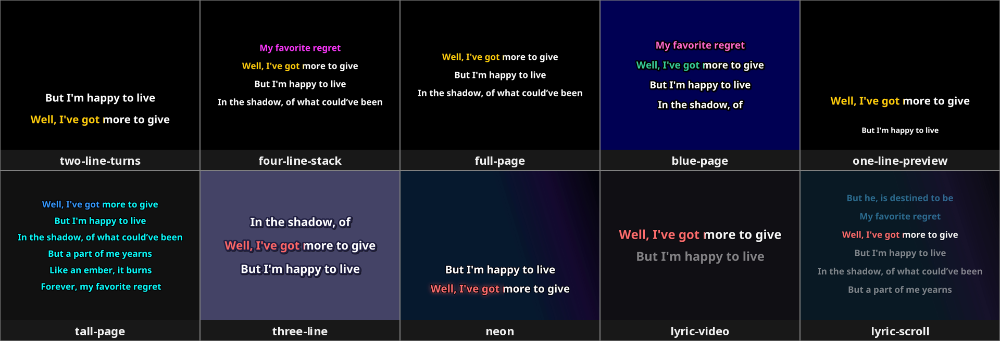

# Vocatron

**Turn your CD collection, your digitized vinyl or your band's own recordings into your private karaoke collection.**

Vocatron turns a song and its lyrics into a karaoke track, locally, with as little manual work as possible.

*"My Favorite Regret" by Josh Woodward feat. Katie Pederson ([CC BY 4.0](https://creativecommons.org/licenses/by/4.0/)), made with the default look `four-line-stack`.*

Give Vocatron a folder of songs. It finds the lyrics, separates the vocals, times every word to the
singing and renders a karaoke video. Then it checks its own result and tells you which songs may
need some manual tuning.

**Use Vocatron only with recordings you have obtained lawfully, and only for your private,
non-commercial use unless the rights holders allow more.** Songs, recordings and lyrics are
protected by copyright: a karaoke track made from them may not be shared, published, performed in
public or used commercially without the permission of the rights holders. You are responsible for
complying with the copyright law that applies to you. Vocatron is provided "as is", without
warranty of any kind, under the MIT licence.

## Features

- **Runs on your machine:** no account, no upload; online only for setup, models and lyrics lookup.
- **Finds the lyrics:** a `.txt` or `.lrc` next to the song, or a lookup when there is none.
- **Separates the vocals** with AI models.
- **Times every word and syllable** to the singing, so the highlight follows the voice.
- **Ten looks:** seven classic, three modern, and your own by name.
- **MP4 video**, and CD+G (MP3+G) for karaoke players when you turn it on.
- **A verdict per song:** `ok`, `review` or `failed`, with the reason.
- **Fix the lyrics, run again:** only what changed is made again.
- **German and English** songs; MIT licensed.

## Ten looks

Seven classic looks and three modern ones, all shown here at the same moment of the same duet
(see [Looks](user/looks.md) for six moments of each, with the break screen and the end
screen):

*"My Favorite Regret" by Josh Woodward feat. Katie Pederson ([CC BY 4.0](https://creativecommons.org/licenses/by/4.0/)).*

## Start here

| Page | What is in it |
|---|---|
| [Installation](user/install.md) | Requirements, setup, models, first track |
| [Everyday use](user/everyday.md) | The workflow from folder to summary |
| [Looks](user/looks.md) | The ten looks, with pictures |
| [FAQ and known limits](user/faq.md) | Questions and what Vocatron does not do |

## Changing Vocatron

| Page | What is in it |
|---|---|
| [Architecture](dev/architecture.md) | Layers, stages and files |
| [Contributing](contributing.md) | How to work on the code |
