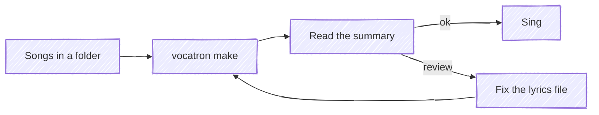

# Everyday use

The whole workflow: put songs in a folder, run one command, read one line per song, look at the
songs that need it, fix their lyrics, run again.



## 1. Put the songs in a folder

Collect the audio and, if you have it, the lyrics.

Audio files (`.mp3 .flac .wav .ogg .opus .m4a`) directly in one folder. If you have the lyrics,
put them next to each song as `Song.txt` (plain text) or `Song.lrc` (with line times); otherwise
Vocatron looks them up and writes what it found next to the song, so you can check and edit them
there. See [Lyrics](lyrics.md).

The lyrics file has exactly the song's name, only the extension differs:
`Queen - Bicycle Race.mp3` and `Queen - Bicycle Race.txt`. Upper and lower case count (only a
Windows drive or a Mac, whose file systems ignore case, also find another case).

Vocatron detects the language of each song from its lyrics; set it for all songs of a run
with `--language` or `lyrics.language` if you know better (see [Languages](languages.md)).

## 2. Run

Make every song in the folder.

```sh
vocatron make ~/Music/party
```

Every song goes from audio to a karaoke MP4 in `~/Music/party/karaoke/`. The songs run one after
the other, sorted by name. On a terminal you see two live lines and the finished songs above them:

```text
ok        5:55   7m 12s  Queen - Radio Ga Ga
review    4:08   5m 02s  Queen - Under Pressure  (alignment: 14% of words estimated (max 10%))
[2/5] 40%  elapsed 12m 14s  about 18m 30s left
Queen - Bicycle Race: separation 41%  about 3m 20s left
```

| Line | Shows |
|---|---|
| Upper | The batch: songs done, percentage, time elapsed and time left. |
| Lower | The song in work: its stage, how far that stage is, and how long the song still needs. |
| Above them | The finished songs. |

The time left is an estimate from the speed of every stage. It starts from measured defaults and
learns the speed of your machine and device from every stage that runs (in `.cache/timings.json`
in the clone of Vocatron, never in git). Stages that will be skipped count zero.

| Mode | Output |
|---|---|
| No terminal (a pipe, a file) | The same information as plain lines: one per finished stage and per song. |
| `--log` | The log of every song (its `log.txt`) streams by as it is written: every line, including the detailed lines of the separation and alignment processes, with the name of the song in front. |

## 3. Read the summary

When the batch is over, Vocatron prints one line per song and a total:

| Column | Meaning |
|---|---|
| State | `ok`, `review`, `failed`, or `running` for a song that was stopped or is being made. |
| Length | The length of the song. |
| Time | How long Vocatron took for it, all stages together. A song that was skipped keeps the time of the run that made it. |
| Name | `Artist - Title`, shortened: with more than two artists only the first and how many more (`Bibi und Tina +6 - Anders ist gut`), without a `(feat. …)` part. |
| Last column | Empty for an `ok` song (its track has the song's name); the reasons in brackets for a `review` song; the stage and the error for a `failed` one. |

Every song takes exactly one line. On a terminal a line that would be wider than the window is
cut with `…`; the full text is in `vocatron-report.txt` and in the song's `log.txt`. When a run is
stopped, the songs not started yet are only counted in the total, not listed.

```text
3 songs: 1 ok, 1 review, 1 failed in 14m 02s
```

The same lines are in `karaoke/vocatron-report.txt` with the date (overwritten by every run),
and `vocatron status ~/Music/party` prints them again from what is stored, without running
anything. Called from a second terminal while `make` is at work, `status` shows the song in work
with its stage, percentage and time left. Each song also has a `report.json` in its work folder
with the verdict, the reasons from every stage, the quality numbers, the time per stage and the
files made.

The exit code is 0 when every song is `ok` or `review`, 1 when a song failed or was stopped, and
2 when the command was used wrongly or the output folder cannot be written.

## 4. Look at the `review` songs

Check what a stage was unsure about.

A `review` song has its track already: Vocatron only says that a stage was unsure. The reasons
name the stage and give numbers: lyrics that were cleaned a lot, many estimated words, a long
silence inside a line. Sing along with the video, or check the lyrics file next to the song
(`vocatron lyrics show` lists what was flagged).

A `failed` song names the stage and the error and has no track; fix the cause (the message says
what) and run again.

## 5. Fix the lyrics and run again

Re-make only what depends on the lyrics.

Edit `Song.txt` next to the song and run `vocatron make` again. Only what depends on the lyrics
runs again (the lyrics, the alignment, the syllables, the layout and the render); the separation
of the song is not repeated.

A second run on an unchanged folder does nothing. `--force` runs every stage again.

## When something goes wrong

What happens when a song fails, takes too long or is stopped.

- **A song fails** (an unreadable file, a stage error, an out-of-memory GPU): the batch goes on
  with the next song. The error is in the summary, in `status.json` and in `log.txt` of the song.
- **A song takes too long:** every song has a safety limit of 10 song lengths plus 10 minutes (set
  `batch.time_limit_factor` and `batch.time_limit_base` in the [configuration](config.md)). When
  it runs out, the stage that is running is stopped, the song is `failed` with "time limit", and
  the batch goes on.
- **The disk is full or a work folder is not writable:** the song is `failed` with the reason
  ("cannot write the work folder"); the batch goes on. The status of such a song cannot be stored,
  so it appears in the summary only. An output folder that cannot be written at all stops the
  command before the first song, with exit code 2.
- **Ctrl-C:** the first one finishes the stage that is running (a stage can take minutes of GPU
  work and its result is kept) and then stops cleanly. The song shows as `running`, "interrupted
  in" the stage that would have come next, and the songs after it were not started. A second
  Ctrl-C stops at once and ends the child processes. Finished work is kept either way: run
  `vocatron make` again and it goes on where it stopped.
