# Looks

The ten looks, how to choose and change one, and how to make your own. A look, called a profile,
decides how the lyrics appear in the [video](video.md): how many lines, their colours, the
countdown, the screens before and after the song.

Vocatron comes with ten looks: seven that follow classic karaoke discs and three modern ones for
the video only. You can change single values of one, or make your own look in a file and check it
before you make a song with it.

## The built-in looks

All looks are drawn from the same duet, "My Favorite Regret" by Josh Woodward feat. Katie Pederson
([CC BY 4.0](https://creativecommons.org/licenses/by/4.0/)), at the same moments of the song. Each
picture has six, three in a row:

- the start screen: the Vocatron wordmark, and title, artist and the singers' names in a frame
  (top left),
- a line sung together, half sung by a group or by all, with the lines sung alone before it still
  on the screen where the look keeps them (top middle),
- a line or page that has just replaced another, after that line sung together (top right),
- the break screen in the long instrumental break, with the finished V above the text (bottom left),
- the countdown at the end of that break (bottom middle),
- the end screen: the wordmark and the frame again, without the build-up (bottom right).

Where two voices sing different lines at once, `four-line-stack`, `two-line-turns`, `three-line`,
`neon` and `lyric-video` show both lines together; the other looks show them one after the other
([The video](video.md)).

All ten looks at the moment "a line sung together":

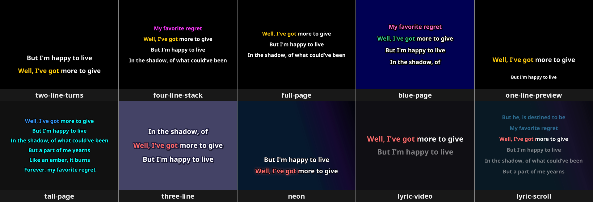

The pictures are made by `make profile-pictures`. The animation on the front page is the default
look: the title screen, then the first lines sung up to the first pause, `make readme-gif`.

- Each classic look has a Video picture and a CD+G picture: the same song on the [CD+G](cdg.md)
  screen, which the look is made for: the text is smaller, the colours are rounded to 12 bits,
  and there are no shadows and no fades.
- The three modern looks at the end of the list use what only a video can show and have no CD+G
  picture.

### `four-line-stack`

The default.

- **Lines:** four stacked in the middle of the screen, replaced two lines at a time: the four slots
  are two blocks of two, and while one block is sung the other is replaced, so the eye moves only
  every two lines (see [Block](#block)).
- **Colours:** white on black; the sung part light blue, pink, green, orange or orchid for the
  singers 1 to 5, yellow for several.
- **Countdown:** dots; a progress bar under "Instrumental" in long breaks.
- **CD+G:** made for it, so adding `cdg` to `outputs` needs no other change.
- For a plainer look with two lines, write `profile: two-line-turns` in `vocatron.yaml`.

#### Video

The six moments in the video.

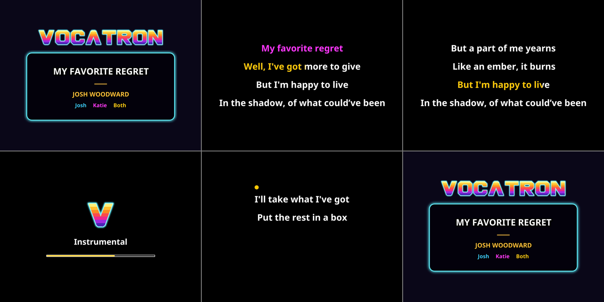

*`four-line-stack`, video.*

#### CD+G

The same six moments; 4 lines of 24 pixels, down to 18, a sweep in steps of 3 pixels.

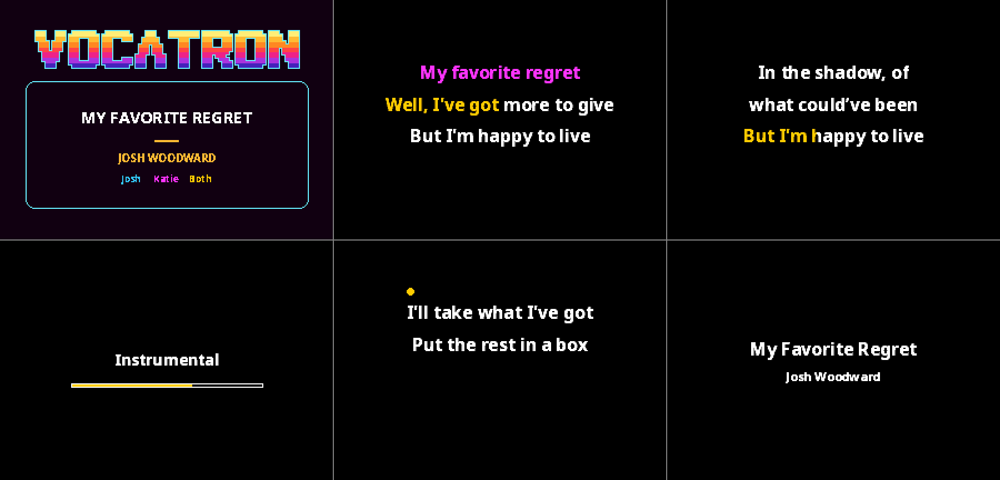

*`four-line-stack`, CD+G.*

### `two-line-turns`

- **Lines:** two in the lower third; the line after the one just sung replaces it.
- **Colours:** white text on black.
- **Countdown:** a bar that shrinks.

#### Video

The six moments in the video.

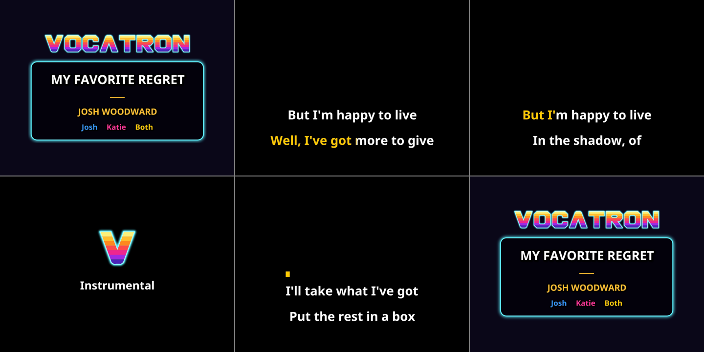

*`two-line-turns`, video.*

#### CD+G

The same six moments; 2 lines of 24 pixels, down to 18, a sweep in steps of 3 pixels.

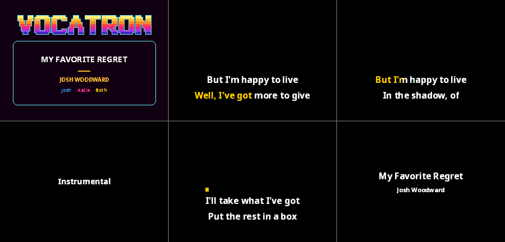

*`two-line-turns`, CD+G.*

### `full-page`

- **Lines:** a page of up to five in the middle that appears together; sung lines keep their sung
  colour until the whole page clears.
- **Colours:** white on black.
- **Countdown:** three dots.

#### Video

The six moments in the video.

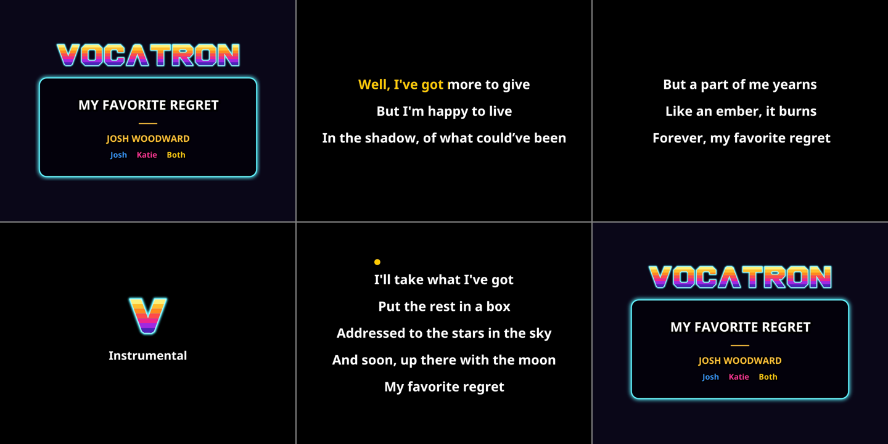

*`full-page`, video.*

#### CD+G

The same six moments; 5 lines of 20 pixels, down to 18, a sweep in steps of 3 pixels.

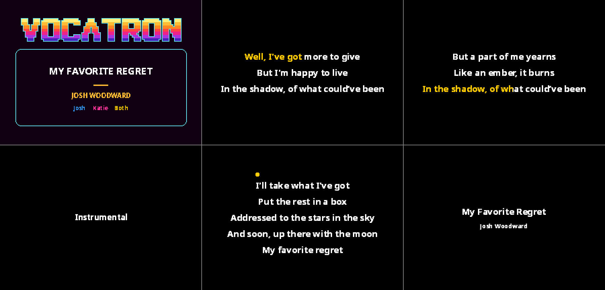

*`full-page`, CD+G.*

### `blue-page`

- **Lines:** pages of four.
- **Colours:** dark blue; red-orange, pink, green, violet or light blue for the singers (sea-green
  for several).
- **Countdown:** blocks; a progress bar in long breaks.

#### Video

The six moments in the video.

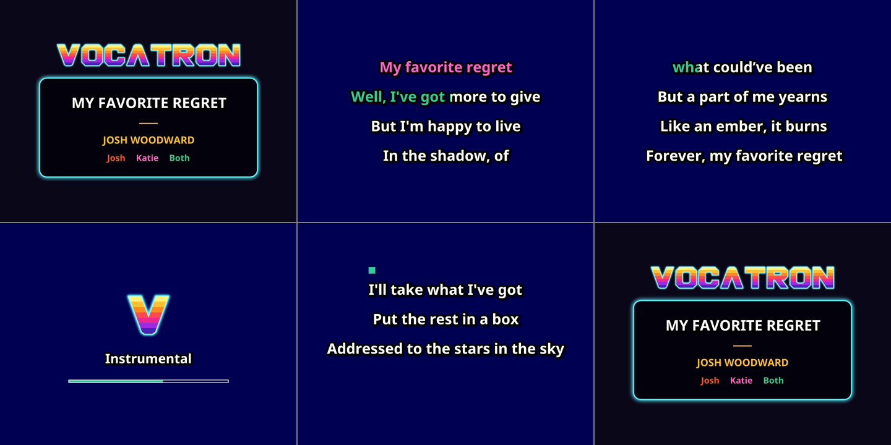

*`blue-page`, video.*

#### CD+G

The same six moments; 4 lines of 24 pixels, down to 18, a sweep in steps of 3 pixels.

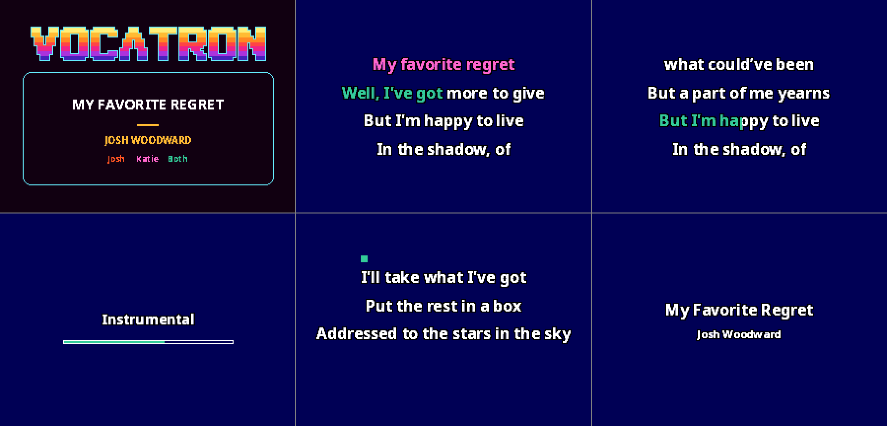

*`blue-page`, CD+G.*

### `one-line-preview`

- **Lines:** one large line in the lower third and, smaller below it, the next line in its unsung
  colour until it moves up.
- **Wide lines:** a line too wide for one row is wrapped onto two rows that appear, are sung and go
  together, so a line is never split over two screens; the preview shows the first row of the next
  line.
- **Options:** switch the preview off with `preview: {show: false}` for a bare single line, or set
  `line_rows: 1` to split long lines as the other looks do.

#### Video

The six moments in the video.

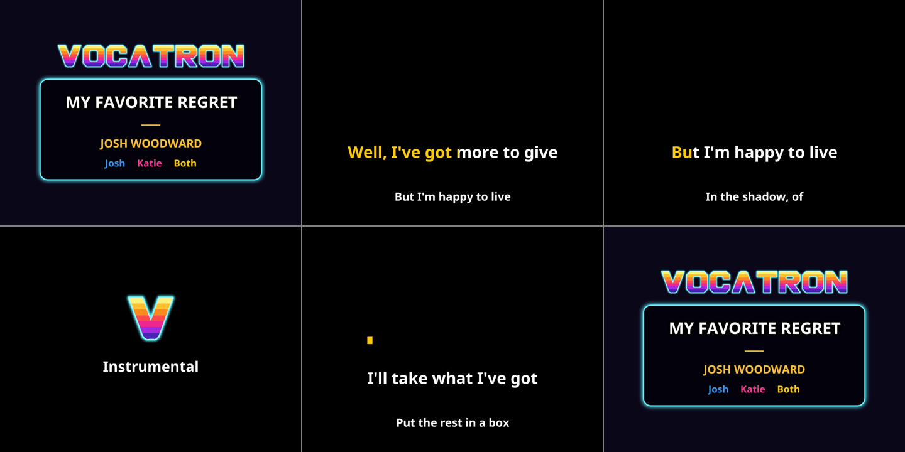

*`one-line-preview`, video.*

#### CD+G

The same six moments; 1 line of 20 pixels, down to 16, a sweep in steps of 3 pixels.

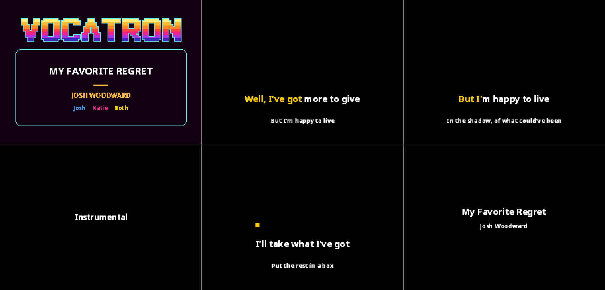

*`one-line-preview`, CD+G.*

### `tall-page`

- **Lines:** pages of up to six rows. A line too wide for one row is wrapped onto two rows that take
  two neighbouring slots, appear together, are sung one after the other and go together, so a page
  never holds more than six rows and a short page sits centred.
- **Colours:** near-black; the unsung text in cyan and a bright colour per singer (magenta for the
  first, orange, green, violet and pink for the others, blue for several).
- **Countdown:** five dots before a line after a gap of eight seconds or more.
- **Hold:** the lines stay four seconds after they are sung.

#### Video

The six moments in the video.

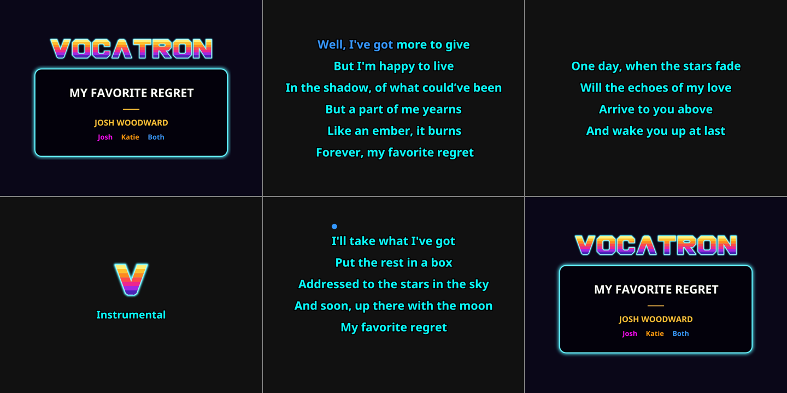

*`tall-page`, video.*

#### CD+G

The same six moments; 6 rows of 23 pixels, down to 18, a sweep in steps of 3 pixels.

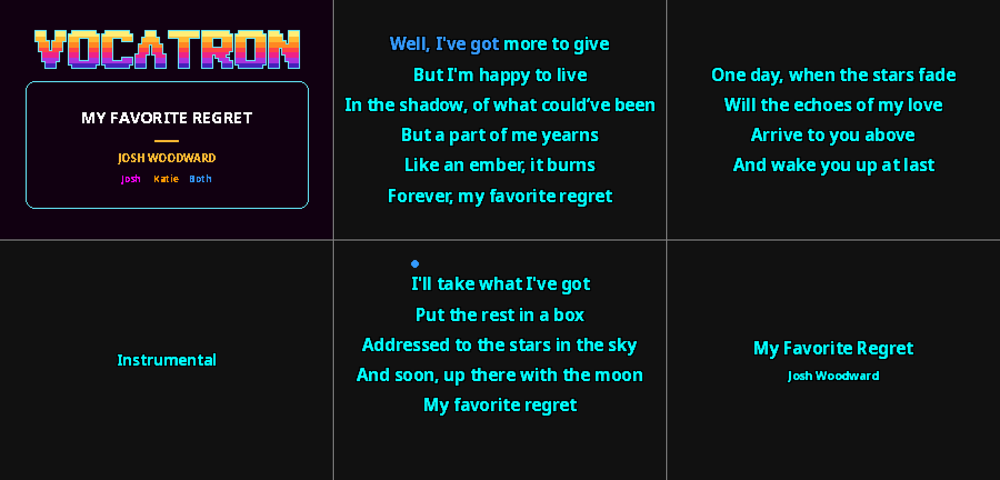

*`tall-page`, CD+G.*

### `three-line`

- **Lines:** three big lines in the middle, replaced one by one as they are sung.
- **Colours:** dark blue-grey. The first singer sings orange to white, the others white to pink,
  green, light blue, lilac or, for several, red.
- **Breaks:** in a break of fifteen seconds or more the screen shows "Instrumental" and, under it,
  the seconds until the next lines appear, counting down.
- **Countdown:** a shrinking bar before a line.
- **CD+G:** the text is large (36 pixels, down to 24, with a 2 pixel outline), so a longer line is
  split over two of the three lines, which sit one under the other, the first part on top.

#### Video

The six moments in the video.

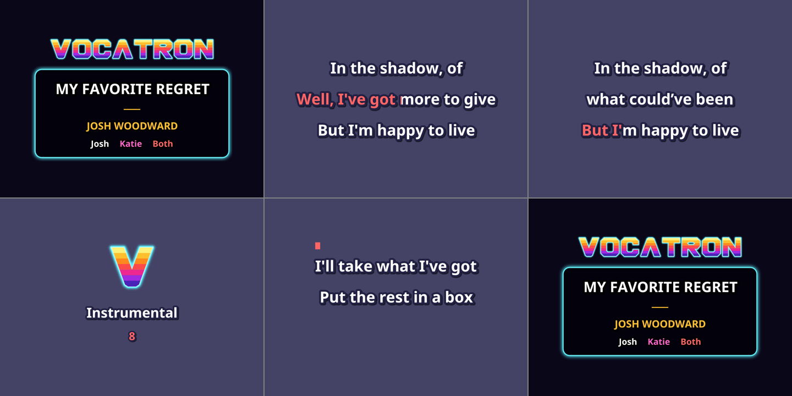

*`three-line`, video.*

#### CD+G

The same six moments; 3 lines of 36 pixels, down to 24, a sweep in steps of 3 pixels.

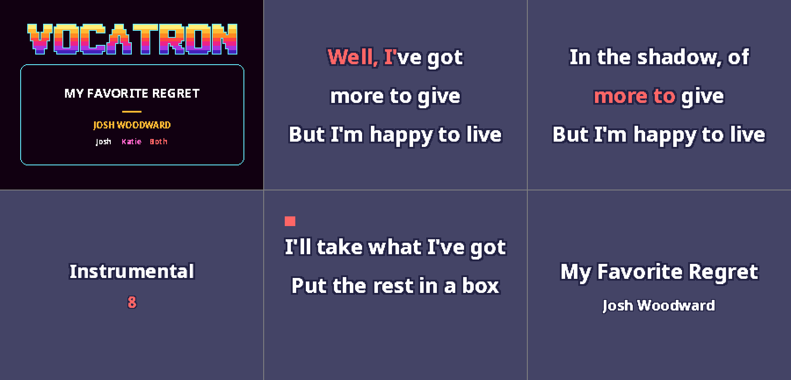

*`three-line`, CD+G.*

### `neon`

A modern look for the video only.

- **Background:** bright words on a near-black gradient of blue and violet that turns slowly.
- **Colours:** the text is white before it is sung and sweeps to cyan, magenta, amber, green or
  violet for the singers 1 to 5 (coral for several); the sung text glows in its colour.
- **Lines:** two in the lower third; they fade in and out over a third of a second.
- **Countdown:** dots; a progress bar in long breaks.

#### Video

The six moments in the video. In this picture the "line or page change" moment falls in the
middle of a fade, so the new line is still partly transparent.

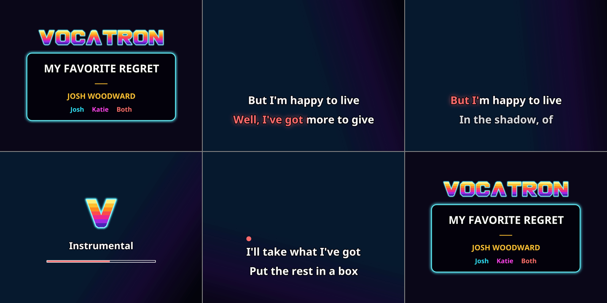

*`neon`, video.*

### `lyric-video`

A modern look for the video only.

- **Text:** large and clean on a dark background, with no outline and a soft shadow.
- **Brightness:** the line being sung is bright; the line coming up is dimmed to half and comes to
  full brightness as its first syllable starts.
- **Motion:** lines slide in from below and out upwards while they fade, over a third of a second.
- **Lines:** two in the middle.
- **Colours:** the sung part orange, sky blue, pink, green or violet for the singers 1 to 5 (coral
  for several).

#### Video

The six moments in the video. In this picture the "line or page change" moment falls in the
middle of a slide, so the new line is still partly transparent.

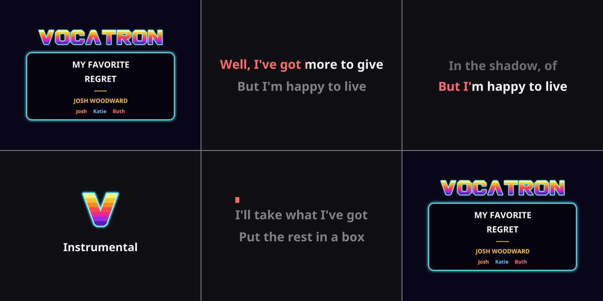

*`lyric-video`, video.*

### `lyric-scroll`

A modern look for the video only, in the style of a lyrics view in a music app: the lyrics are a
column that glides up. See [Scrolling lyrics](#scrolling-lyrics).

- **Column:** the line being sung stands still a little above the middle of the screen; the two
  lines sung before it are above it and the next three below, all dimmed to half, and the dimmed
  lines are the same size.
- **Glide:** in the silence before the next line the whole column glides up by one line in 0.4
  seconds; where lines follow quickly the glide takes at least 0.3 seconds and starts while the
  line before is still finishing.
- **Text:** large and clean with a soft shadow on a dark background that turns slowly; a line too
  wide for one row is wrapped onto two rows that move together.
- **Breaks:** a long break has a screen of its own: the lines fade out, "Instrumental" stands
  alone in the middle, and the column glides in from below again when the break ends.
- **Countdown and title:** the countdown stands just above the next line, and after the title the
  column glides in from below.

#### Video

The six moments in the video. In this picture the "line or page change" moment falls in the
middle of a glide of the column.

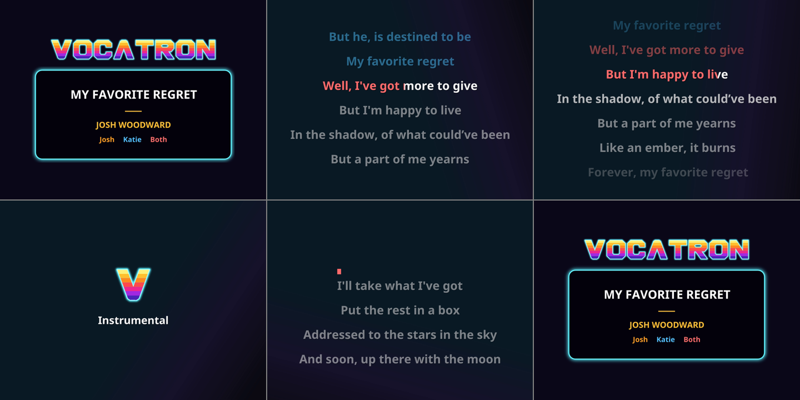

*`lyric-scroll`, video.*

## Which look for what

| For | Look |
|---|---|
| A TV at a party, a few friends reading along | `four-line-stack` (the default) |
| A karaoke machine that plays CD+G | a classic look such as `two-line-turns` or `full-page` |
| A projector or a lyric video | `neon` or `lyric-video` |
| Long lines or a small screen | `full-page` |

Any of the others works too; the table only says where each look is at its best.

## Scrolling lyrics

A look can show its lyrics as a column that glides up instead of lines in fixed places. Set
`mode: scroll`; the section `scroll` sets the rest, and all its keys have defaults:

```yaml
mode: scroll
line_rows: 2                  # a long line wraps onto two rows that move together
scroll:
  current: 0.42               # the middle of the line being sung, as a share of the safe area
                              # from its top, 0.2 to 0.8
  before: 2                   # sung lines kept above it, 0 to 2
  after: 3                    # upcoming lines below it, 1 to 4
  glide: 0.4                  # seconds the column takes to glide up, 0.2 to 1
  min_glide: 0.3              # the shortest a glide between two lines takes, 0.1 to 1, not more
                              # than glide; if left out 0.3, or glide if that is shorter
  dim_sung: 0.5               # how much a sung line (and its glow) is dimmed, 0 to 0.8;
                              # upcoming.dim if left out
upcoming: {dim: 0.5}          # how much the lines that are not sung yet are dimmed
```

- **Glide:** the column stands still while a line is sung and glides up in the silence between
  two lines.
    - Where the silence is shorter than `glide`, the glide is shorter, but never shorter than
      `min_glide`: it starts earlier, during the last moment of the line that is finishing, so that
      line drifts up while its last words are sung (the wipe goes on as it moves).
    - The column then never moves faster than one line per `min_glide` seconds, even when lines
      follow without a pause.
    - A glide still ends before the next line is sung, and never starts before the column has come
      to rest at the line before (a line sung for less than `min_glide` may glide out shorter).
    - With `wipe.offset` the glide keeps out of the shifted wipe where there is room.
- **Lines shown:** only as many as `before` and `after` say and as fit the safe area. Every line
  is shown as soon as there is room for it, so it is on screen longer than `lead_in.max`; the
  lead-in maximum counts for the first line only.
- **Break screen:** a gap of `breaks.notice_after` seconds or more, if it leaves room, ends a part
  of the column and shows the break screen alone, as in the page looks.
    - The lines on screen go `clear.hold` seconds after the singing stops, or sooner where the next
      line's lead-in needs it, as the page looks clear the screen. They fade out over the
      `ending.fade` seconds before (never while a line is still sung); no line of the next part is
      on screen before the screen ends.
    - The break screen (the V, "Instrumental" and, with `breaks.form: progress` or `timer`, the
      bar or the timer) stands still in the middle of the safe area for at least a second.
    - Then the column comes back as after the title screen: it glides in from below with the next
      line at the current height, and the countdown starts when it rests. The bar or the timer
      ends when that glide starts.
    - A gap shorter than that, also one between `breaks.clear_after` and `breaks.notice_after`,
      shows no screen: the column waits there and glides on; nothing is cleared.
- **Countdown and end:** a countdown stands just above the line it counts in and starts when the
  column has come to rest for that line. After the last line everything stays for `clear.hold` seconds, but at the
  latest until the end screen starts (`ending.start_after`), which follows as in the other looks.
- **Limits:** `slots`, `page` and `preview` do not apply; the check refuses `preview.show`, a
  `page` section and a `transition` (the glide is the motion), and a `scroll` section without
  `mode: scroll`. A look that scrolls cannot have a `cdg` section: CD+G cannot move text smoothly. The `glow`
  effect is not dimmed with the line.

## Effects of the video

The classic looks keep to what a CD+G disc can show. A look for the video only can use five
effects. Each is a section of the profile and is off by default:

```yaml
glow: {sung: 0.6}                      # a soft glow around the sung text, 0 (off) to 1
pop: {scale: 1.1, time: 0.25}          # the word being sung grows by 10 % and settles back
transition: {form: fade, time: 0.3}    # lines fade (or slide) in and out
upcoming: {dim: 0.5}                   # lines that are not sung yet are dimmed to half
background_motion:                     # a slowly turning gradient instead of the plain colour
  colours: ["#04050c", "#150a30", "#061a2e"]
  speed: 0.01
```

- `glow.sung` is the strength, 0 to 1; `glow.colour` sets the colour of the glow, which is the
  sung colour of the singer otherwise. The glow is a blurred copy of the text that grows with
  the colour sweep, so it shows exactly where the sweep has been.
- `pop.scale` is how much larger the word gets, 1 to 1.15; `pop.time` the seconds from the start
  of the word until it is back to size. The growing word pushes the rest of the line to the right
  for a moment, so the line is fitted with room for it on the right: a line that just fits without
  `pop` is split or made smaller with it, and a centred line sits a little left of the middle.
- `transition.form` is `none`, `fade` or `slide` (a fade that also moves the line up from below
  when it comes in, and up and out when it goes, by 0.4 of the height of its place); `transition.time` is how long it takes, at most
  one second. A transition never reaches into the singing: a line is fully in before its first
  syllable and starts to go after its last, so where a line is replaced the moment it has been
  sung there is no transition, and one shorter than 0.05 seconds is left out. The rows of a line
  wrapped onto two rows come and go together; the parts of a split line each in their own place.
- `upcoming.dim` is 0 to 0.8: a line that is on screen before it is sung is dimmed by that much
  and brought back to full over the last 0.3 seconds before its first syllable (before its wipe,
  where `wipe.offset` moves that earlier).
- `background_motion.colours` are two to four colours, `speed` how fast the gradient turns (0 to 1,
  0.01 by default). The text must stand out against the darkest and the lightest of the colours.
  With a moving background the plain `background` colour is not drawn.

`vocatron profiles check` judges the contrast against the darkest and the lightest colour of a
moving background, and the unsung text of a dimmed line at its reduced brightness. A look with an
effect must not have a `cdg` section, because the CD+G screen cannot draw any of this; the check
refuses it and points at the section. Rendering a look with a moving background takes about a fifth
longer than a plain one.

## Choosing a look

Choose a look by name in `vocatron.yaml`, or for one run with `--profile`, and override single
values with `profile_overrides`:

```yaml
profile: two-line-turns          # a name, or a path: looks/mine.yaml
profile_overrides:
  font: {size: 0.1}              # smaller text
  slots: 3                       # three lines at a time
  breaks: {form: progress}       # a progress bar in long breaks
  colours:
    singer1: {sung: "#ff6600"}
  countdown: {form: dots}
```

`vocatron profiles` lists the built-in looks and your own, each with a one-line description, its
mode, the number of lines on screen (slots), whether it is made for [CD+G](cdg.md) and where it
comes from. The look the configuration chooses is marked with `*`; an own file that does not load
is listed as invalid.

A value without a path separator and without `.yaml` or `.yml` at the end is a name (a built-in
look, or a file of your profiles folder); anything else is a path. Write `./mine` or `mine.yaml`
for a file.

## Make your own look

1. **Set a folder for your profiles.** In `vocatron.yaml` (the folder is relative to the file):

    ```yaml
    profiles_folder: looks
    ```

    Your own looks are the files ending in `.yaml` in that folder; the name of a look is the
    name of its file without `.yaml`.

2. **Copy a built-in look** that is close to what you want:

    ```sh
    vocatron profiles copy blue-page mine
    ```

    This writes `looks/mine.yaml`, with a header that says where it comes from and the name set
    to `mine`. Without a second argument the copy is called `my-blue-page`; a path such as
    `./mine.yaml` writes there instead of into the folder. An existing file is never overwritten.

3. **Edit the file** with any text editor. The keys are in the table below.

4. **Check it:**

    ```sh
    vocatron profiles check mine
    ```

    The check does not render anything. It tests that:

    - the file loads,
    - its colours can be told apart from the background and from each other,
    - its lines fit the safe area of every output preset,
    - the layout rules hold on sample lyrics and the folk songs.

    A look with a `cdg` section (`made_for_cdg: true`) is checked on the CD+G screen too, which
    takes a few seconds; an MP4-only look is not. A problem is printed with the place that causes
    it:

    ```text
    ~/karaoke/looks/mine.yaml:18:13: colours.singer1.unsung: has contrast 1.4 with the background
    ```

    A clean profile prints `ok`. The exit code is 0 when the profile is fine, 1 when it has
    problems and 2 when the configuration or the name is wrong. The `profile_overrides` of your
    configuration are applied first, and the check names them
    ([Commands](commands.md#profiles-check)).

5. **Choose it** with `profile: mine` in `vocatron.yaml`.

6. **Render a song with it:**

    ```sh
    vocatron render ~/Music/party/Song.mp3
    ```

A name that is built in and also a file in your folder is an error, so that a look never changes
by accident when a file appears: to change single values of a built-in look use
`profile_overrides`, to start from it use `vocatron profiles copy`. A name that is not known is an
error that lists the names that exist.

A mistake in a profile file is reported with its place, at every command that loads it:

```text
looks/mine.yaml:12:3: font.size: Input should be less than or equal to 0.4
profile_overrides.slots: Input should be less than or equal to 6
```

## The values of a profile

`profile_overrides` has the same keys as a profile file.

| Key | Meaning |
|---|---|
| `name`, `description` | The name (the name of the file without its ending) and one line about the look, shown by `vocatron profiles`. |
| `mode` | `line` (lines are replaced one by one as they are sung), `page` (a page of up to `slots` lines appears and clears together) or `scroll` (a column of lines that glides up, the line being sung at a fixed height; for the video only, see [Scrolling lyrics](#scrolling-lyrics)). |
| `slots` | How many lines are on screen at once (1 to 6); not used with `mode: scroll`. |
| `block` | `mode: line` only: how many neighbouring slots turn together (1 to 3; 1 by default, one line at a time). `slots` (and `cdg.slots`) must be a multiple of `block`, with at least two blocks. See [Block](#block). |
| `scroll` | The column of `mode: scroll`: `current`, `before`, `after`, `glide`, `min_glide` and `dim_sung`, see [Scrolling lyrics](#scrolling-lyrics). Only with `mode: scroll`. |
| `line_rows` | How many rows a lyric line may be wrapped onto (1 or 2; 1 by default). A line too wide for one row is shown as one block of up to `line_rows` rows that appear, are sung and go together; a line that does not fit even then is shrunk down to `font.min_size` and, if that is not enough, split into lines as with one row. Each slot is `line_rows` rows high, so use few slots or a smaller font with 2. |
| `page.min_lines` | Page mode: a page has at least this many lines where the song allows it (1 by default, at most `slots`). |
| `page.slot_per_row` | Page mode with `line_rows: 2` (and at least two `slots`): each slot is one row high and a line wrapped onto two rows takes two neighbouring slots, so a page holds at most `slots` rows (`false` by default; the look `tall-page`). A line that would not fit in the rows left starts the next page. |
| `page.turn` | Page mode: how a page gives way to the next. `page` (the default; every built-in look) turns the whole page at once. `line` fills a slot with the line of the next page as soon as the line in it has been sung (plus `clear.replace_after`, and never after the new line's own first syllable): the next page builds from the top while the old one is still sung below, so a page that follows with no pause is complete when its first line is sung. After a long break (`breaks.clear_after`) the whole page turns at once. CD+G sets it itself for a song that is too late with whole pages (see [CD+G](cdg.md#when-a-song-is-too-dense)); a look of your own may choose `line` for the video too. Needs `mode: page`. |
| `preview` | `show` the next line smaller below the line being sung (needs `mode: line` and `slots: 1`; off by default) and its `scale` (0.4 to 0.9 of the line, 0.7 by default). |
| `align`, `position` | `center`, `left` or `right`; `top`, `middle`, `lower-third` or `bottom`. |
| `safe_area` | The share of the picture that text stays inside (0.9). |
| `font.size`, `font.min_size`, `font.case` | The height of a line as a share of the safe area's height; the smallest it is shrunk to; `as-written`, `upper` or `lower`. The font itself is the bundled Noto Sans Bold. |
| `background` | The plain background colour. |
| `colours` | `unsung`, `sung` and `edge` for `singer1` to `singer5` and `group`. |
| `edge.width`, `shadow` | Outline width and shadow offset as shares of the font size; the shadow's colour and opacity. |
| `wipe` | `smooth` (linear through each syllable) or `syllable` (the whole syllable switches at its start); `offset` shifts every wipe by up to half a second. |
| `lead_in` | `min`, `target` and `max` seconds a line is shown before it is sung. |
| `clear` | `hold` after the singing before a long gap and after the last line (where the look shows an end screen the lines go at the latest when it starts, `ending.start_after` after the singing stops, even if `hold` is longer), and `replace_after` before a slot is refilled. |
| `intro` | `solo` and `group`: the least seconds from the start of the video to the first sung word of a song with one singer, and of a duet or group (8 and 9 by default); silence is added at the start for what is missing, `0` for both turns it off. See [The karaoke video](video.md). |
| `glow`, `pop`, `transition`, `upcoming`, `background_motion` | The effects of the video, off by default: see [Effects of the video](#effects-of-the-video). Not with a `cdg` section. (`transition` does not go with `mode: scroll`.) |
| `cdg` | How the look is simplified for [CD+G](cdg.md): `made_for_cdg` (the marker; without the section or with `false` the look is MP4 only), `slots`, `font_px` and `min_font_px` (the height of a line in pixels), `edge_px` (1 or 2), `wipe_columns` (1, 2, 3 or 6) and `colours` (`#rgb` or `#rrggbb` overrides). The built-in looks have it; leave it out for a look that is for the video only. |
| `breaks`, `countdown`, `title`, `ending` | The gap lengths and the screens described in [The karaoke video](video.md). `breaks.form` is `notice` (the text only), `progress` (a bar under the text that fills until the next line appears) or `timer` (the whole seconds until the next lines appear, counting down under the text, in the colour of the group); `title.form` is `wordmark` (the default: the Vocatron wordmark on its own dark field with the title and artist in capitals in a frame, the same in every look, and the same screen without the build-up at the end; the break screen has the finished V above its text) or `plain` (cards of centred text in the colours of the look, for all three screens; CD+G has the wordmark start screen too, in a pixel form, unless the screen lasts less than four seconds, and plain break and end screens); `countdown.form` is `shrinking-bar`, `dots` or `blocks` (square dots); `countdown.count` is the number of beats the countdown lasts, which is also the number of dots or blocks, and `countdown.duration` is its length in seconds when the song's tempo is unclear. |

### Contrast

- Colours must differ enough from the background and from each other, and the sung colour of a
  singer must differ in lightness from the unsung one (a contrast of at least 1.5), so that the
  wipe can be followed: yellow on white (1.07) is not allowed.
- The built-in looks meet the contrast rules, your own may not.
- A profile that does not still renders, and the song is marked `review` with the colours that are
  hard to read as its reasons; `vocatron profiles check` tells you before.

### Block

`block` (`mode: line` only; 1 to 3; 1 by default, one line at a time) says how many neighbouring
slots turn together. The look `four-line-stack` uses `block: 2`.

- With `block: 2` the slots form blocks of two and the lines are counted in pairs in the order they
  are sung: both lines of a pair appear together, and the lines in that block go at the same
  moment, once the pair in it has been sung and the next pair has started.
- A line wrapped onto two rows of its slot (`line_rows: 2`) counts as one line.
- A line split over several lines (see `line_rows`) is never put together with another one: its
  parts fill a block of their own (with `block: 3`, a line split in two leaves the third slot
  empty).
- After a long break the counting starts again in the top block.
- A pair before a break or at the end may be a single line, which sits next to the other block (in
  the bottom slot of an upper block, in the top slot of a lower one), so no empty row stays between
  the lines on screen.
- When lines are held so long that every block still has a line being sung as the next pair starts,
  that pair is shown line by line instead, each line in the slot that is free first.
- `slots` (and `cdg.slots`) must be a multiple of `block`, with at least two blocks.
